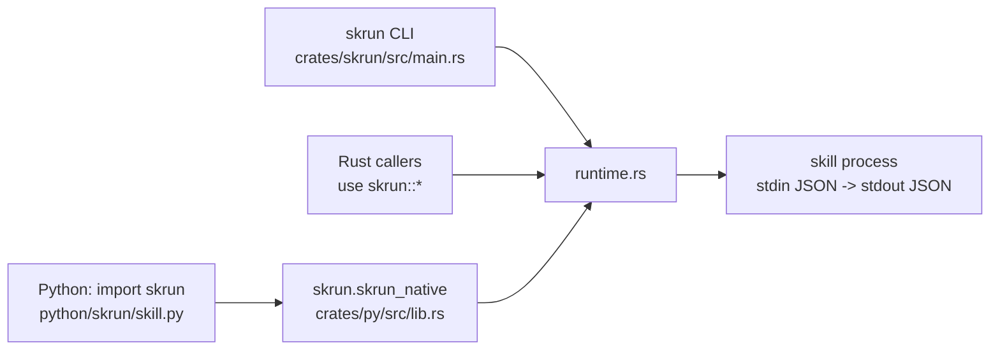

Skill behaviour lives in one Rust module, `crates/skrun/src/runtime.rs`; a second module, `catalog`, only does bookkeeping for a directory of guidance skills ([[reference]]). The `skrun` crate re-exports the runtime as a library and also ships the `skrun` CLI binary. Python reaches the same code through `skrun-native` (`crates/py`), a PyO3 extension that maturin installs as `skrun.skrun_native`; the pure-Python `skrun` package only converts arguments and JSON.

Because the Python package has no subprocess fallback, a Python call and a CLI call validate and execute a skill identically.
