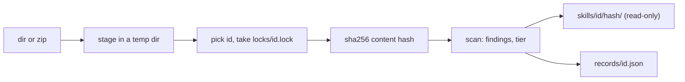

The id is `--id`, else the source's name (directory or zip stem, from the real path, so `add .` works), else the unquoted frontmatter `name` if that is not a valid id ([[reference]]). Two sources with the same name become versions of one id unless `--id` separates them.

`records/<id>.json` lists each version: hash, `--from`, time, file and byte counts, frontmatter name and description, scripts with language and imports, findings, tier and reasons. It is written atomically under the per-id lock. Identical content stores nothing new; a scan that now differs refreshes that version's scripts, findings and tier.
