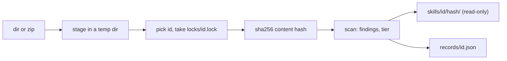

The id is `--id`, else the source's own name (directory name or zip stem, from the real path, so `add .` works), else the frontmatter `name` without YAML quotes when the source name is not a valid id ([[reference]]). So two authors' same-named skills stay apart.

`records/<id>.json` lists each version: hash, `--from`, time, file and byte counts, frontmatter name and description, scripts with language and imports, findings, tier and reasons. It is written to a temporary file and renamed under the per-id lock. Identical content stores nothing new; a scan that now differs refreshes that version's scripts, findings and tier.
