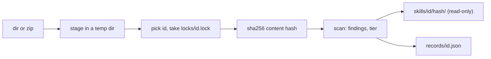

The store root is `--store`, else `$SKRUN_STORE`, else `~/.skrun/store`. The id is `--id`, else the source's own name (the directory name or the zip file stem, taken from the real path, so `add .` works), else the frontmatter `name` with YAML quotes stripped when the source name is not a valid id ([[reference]]). Preferring the source name keeps two authors' skills with the same `name` apart.

The content hash covers every file's path and bytes; a short prefix names the version directory, which is built beside its place and renamed in, so a version never appears half written. `records/<id>.json` lists every version: hash, `--from`, time, file and byte counts, frontmatter name and description, scripts with language and Python imports, findings, tier and reasons. It is written to a temporary file and renamed, under the per-id lock. Adding identical content stores nothing new; only a scan that now differs refreshes that version's scripts, findings and tier.
