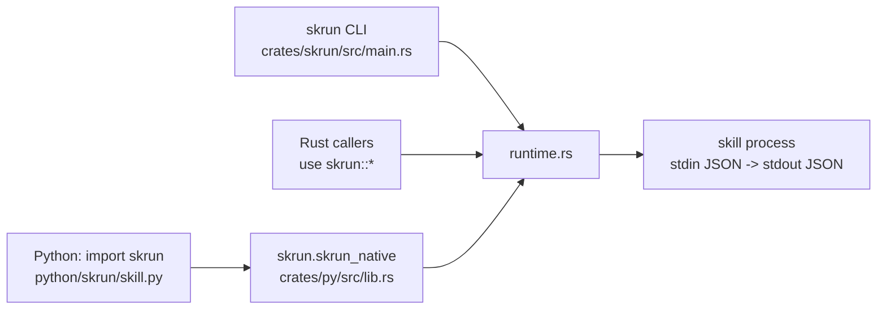

所有行为都在一个 Rust 模块 `crates/skrun/src/runtime.rs` 中。`skrun` crate 既把它作为库重新导出，也附带 `skrun` CLI 二进制。Python 通过 `skrun-native`（`crates/py`）调用同一份代码，这是一个 PyO3 扩展，由 maturin 安装为 `skrun.skrun_native`；纯 Python 的 `skrun` 包只负责转换参数和 JSON。

由于 Python 包没有子进程后备方案，通过 Python 调用和通过 CLI 调用时，skill 的校验和执行方式完全相同。
