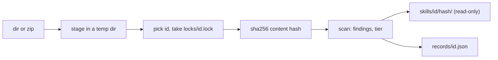

id 依次取 `--id`、源自身的名字（目录名或 zip 文件名去掉扩展名，取自真实路径，所以 `add .` 也可用），当源的名字不是合法 id 时再取去掉 YAML 引号的 frontmatter `name`（[[reference]]）。两个同名的源会归到同一个 id 下成为不同版本，需要用 `--id` 区分。

`records/<id>.json` 列出每个版本：哈希、`--from`、时间、文件数和字节数、frontmatter 的 name 和 description、带语言和导入的脚本、发现项、等级及理由。它在 per-id 锁之下先写入临时文件再改名。完全相同的内容不会存入新版本；扫描结果变化时才刷新该版本的脚本、发现项和等级。
