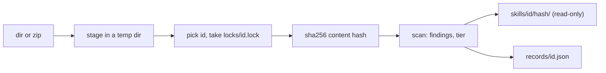

存储根目录依次取 `--store`、`$SKRUN_STORE`、`~/.skrun/store`。id 依次取 `--id`、源自身的名字（目录名或 zip 文件名去掉扩展名，取自真实路径，所以 `add .` 也可用），当源的名字不是合法 id 时再取去掉 YAML 引号的 frontmatter `name`（[[reference]]）。优先使用源的名字，能让两位作者同 `name` 的 skill 保持分开。

内容哈希覆盖每个文件的路径和字节；用它的一段短前缀命名版本目录，该目录先在旁边建好再改名就位，所以版本绝不会以写了一半的状态出现。`records/<id>.json` 列出每个版本：哈希、`--from`、时间、文件数和字节数、frontmatter 的 name 和 description、带语言和 Python 导入的脚本、发现项、等级及理由。它在 per-id 锁之下先写入临时文件再改名。再次添加完全相同的内容不会存入新版本；只有扫描结果变化时，才会刷新该版本的脚本、发现项和等级。
