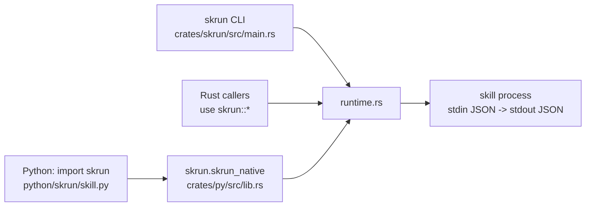

# Overview

**English** · [中文](zh/01-overview.md)

skrun is a small local runtime for *skills*: directories that package either guidance text (`SKILL.md`) or an executable program behind a fixed JSON contract. It scaffolds, builds, installs and runs those directories, so an agent framework you already use (LangChain, LangGraph, PydanticAI, OpenAI Agents) can call a Rust binary or a uv-managed Python script as an ordinary function that takes a dict and returns a dict.

It deliberately does not plan, chat, store state or manage credentials: the runtime module lists those as things it must not own. You keep your agent loop; skrun is the part that turns "a tool on disk" into "one JSON in, one JSON object out".

Start with [Getting Started](02-getting-started.md), look up exact names in [Reference](03-reference.md), and read [How It Works](04-how-it-works.md) for how a call is executed.

Sources: [runtime.rs:1-37](../crates/skrun/src/runtime.rs#L1-L37) · [README.md:11-19](../README.md#L11-L19)

## Three kinds of skill

Every skill directory has a `kind` (`ArtifactKind`):

| kind | what it is | how it runs |
|---|---|---|
| `markdown` | guidance only, usually just `SKILL.md` | never; listed and shown, refused by `build` and `run` |
| `rust_binary` | a Cargo project | the built executable at `entry` |
| `python_uv` | a uv project | `uv run --project <dir> python <entry>` |

`SkillArtifact::validate` ties `executable` to the kind: markdown skills must have `executable: false`, the other two must be executable and must name an `entry` and use the `stdio-json` transport. This is why one directory format can serve both prompt-style skills and real programs.

Sources: [runtime.rs:55-61](../crates/skrun/src/runtime.rs#L55-L61) · [runtime.rs:206-241](../crates/skrun/src/runtime.rs#L206-L241)

## One runtime, three front doors

All behaviour lives in one Rust module, `crates/skrun/src/runtime.rs`. The `skrun` crate re-exports it as a library and also ships the `skrun` CLI binary. Python reaches the same code through `skrun-native` (`crates/py`), a PyO3 extension that maturin installs as `skrun.skrun_native`; the pure-Python `skrun` package only converts arguments and JSON.

Because the Python package has no subprocess fallback, a Python call and a CLI call validate and execute a skill identically.

Sources: [lib.rs:1-13](../crates/skrun/src/lib.rs#L1-L13) · [lib.rs:103-129](../crates/py/src/lib.rs#L103-L129) · [skill.py:295-321](../python/skrun/skill.py#L295-L321) · [pyproject.toml:38-44](../pyproject.toml#L38-L44)

## Why the workspace is this small

skrun grew out of a larger agent project. Until October 2026 the workspace still carried fourteen crates of that old agent core (agent, chat, engine, server, store and others) plus duplicate copies of the runtime and CLI in `crates/runtime` and `crates/cli`. None of them were used by a published surface, so commit `b6a4feb` removed them, kept only `crates/skrun` and `crates/py`, and pointed the PyO3 module straight at `skrun`. Earlier, `b4c1afe` had already made `skrun` self-contained so it can be published to crates.io without internal workspace crates. The result is one runtime crate and one binding crate.

Sources: [commit b6a4feb](https://github.com/lhwzds/skrun/commit/b6a4feb) · [commit b4c1afe](https://github.com/lhwzds/skrun/commit/b4c1afe)
