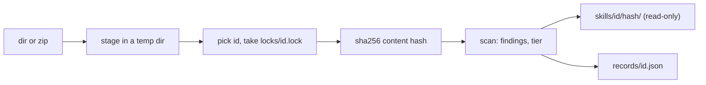

# Store and Risk Tiers

<sub>**English** · [中文](zh/05-store.md)</sub>

`skrun catalog add` copies a skill from elsewhere (another repository, a downloaded zip) into a local store; `inspect` shows what arrived. Neither executes, builds or imports anything from the skill, nor reaches the network: the store is where you look before installing ([How It Works](04-how-it-works.md)).

```bash
skrun catalog add <dir|zip> [--store <dir>] [--id <id>] [--from <provenance>] [--json]
skrun catalog inspect <id> [--store <dir>] [--json]
skrun catalog inspect --list [--store <dir>] [--json]
```

`add` prints `stored`, `already stored` or `already stored (record refreshed)` with id, version hash, file and finding counts and tier; `--json` prints the version record. `inspect` prints each version's provenance, scripts, findings by severity and tier reasons; `--list` prints each id's newest version on one line. Every printed string goes through `redact`, even from a hand-edited record.

<sub>Sources: [main.rs:676-771](../crates/skrun/src/main.rs#L676-L771) · [main.rs:858-923](../crates/skrun/src/main.rs#L858-L923) · [store.rs:646-785](../crates/skrun/src/store.rs#L646-L785) · [store.rs:583-635](../crates/skrun/src/store.rs#L583-L635)</sub>

## What add stores



The id is `--id`, else the source's own name (directory name or zip stem, from the real path, so `add .` works), else the frontmatter `name` without YAML quotes when the source name is not a valid id ([Reference](03-reference.md)). So two authors' same-named skills stay apart.

`records/<id>.json` lists each version: hash, `--from`, time, file and byte counts, frontmatter name and description, scripts with language and imports, findings, tier and reasons. It is written to a temporary file and renamed under the per-id lock. Identical content stores nothing new; a scan that now differs refreshes that version's scripts, findings and tier.

<sub>Sources: [store.rs:363-539](../crates/skrun/src/store.rs#L363-L539) · [store.rs:805-895](../crates/skrun/src/store.rs#L805-L895) · [store.rs:2037-2097](../crates/skrun/src/store.rs#L2037-L2097) · [catalog.rs:1208-1233](../crates/skrun/src/catalog.rs#L1208-L1233)</sub>

## Version hashes and file modes

`content_hash` feeds sha256, per file in path order, the path length as a big-endian u64, the path, the content length, then the content, so different file sets never share a hash. Its first 16 hex characters name the version directory; if that directory holds other content, `version_name` uses 32, then 64, so different content is never taken as already stored.

A version is copied beside its place and renamed in, never half written. Store directories are `0700`, stored files `0400` and their directories `0500`, records `0600`.

<sub>Sources: [store.rs:82-107](../crates/skrun/src/store.rs#L82-L107) · [store.rs:541-572](../crates/skrun/src/store.rs#L541-L572) · [store.rs:828-837](../crates/skrun/src/store.rs#L828-L837) · [store.rs:1264-1328](../crates/skrun/src/store.rs#L1264-L1328) · [store.rs:1856-1886](../crates/skrun/src/store.rs#L1856-L1886)</sub>

## What add refuses

The source is staged in a fresh temporary directory first; a refused source never reaches the store. `add` fails on:

- a source that is itself a symlink. Symlinks inside a directory are never followed or copied; each becomes a `symlink` finding;
- a source, file or zip entry name that is not UTF-8;
- a zip entry with an absolute path or one leaving the archive root, a symlink entry, more than 5,000 entries, more than 50 MB uncompressed, or an entry compressed over 100 times, counted on the bytes actually written, not just declared sizes;
- no `SKILL.md` at the top level or inside a single top-level folder (so a zip of a repository folder works);
- an invalid id, or another `add` holding the id's lock for 10 seconds.

Directory copies skip `.git`, `.venv`, `__pycache__`, `node_modules` and `target`.

<sub>Sources: [store.rs:73-116](../crates/skrun/src/store.rs#L73-L116) · [store.rs:897-919](../crates/skrun/src/store.rs#L897-L919) · [store.rs:940-1025](../crates/skrun/src/store.rs#L940-L1025) · [store.rs:1027-1262](../crates/skrun/src/store.rs#L1027-L1262) · [store.rs:1952-1970](../crates/skrun/src/store.rs#L1952-L1970)</sub>

## Risk rules

`scan_skill` reads each file as lossy UTF-8; a rule reports its first match per file as `path:line`. Binary files and files over 16 MB (`MAX_SCAN_BYTES`) skip these rules, not the secret check.

| severity | rule | finds |
|---|---|---|
| high | `remote_exec` | curl or wget piped into a shell or Python; `iex`, `Invoke-Expression`, `DownloadString` |
| high | `decode_exec` | a decode call (`b64decode`, `fromhex`, `atob`, base64 `Buffer.from`, …) within 160 characters before exec, eval, compile or sh |
| high | `reverse_shell`, `cred_theft`, `exfil_endpoint`, `persistence`, `av_evasion` | /dev/tcp, nc -e; SSH keys, AWS credentials, Keychain, browser cookies, wallets; webhook or paste services, public IPv4 URLs; cron, LaunchAgents, shell rc files; quarantine, Gatekeeper, SIP or Defender bypass |
| high | `binary` | a binary extension or magic number (ELF, Mach-O, PE) |
| medium | `obfuscation`, `social_engineering` | long base64 or hex-escape runs, many `_0x` identifiers; in Markdown and text, paste-into-terminal or password-protected archive lures |
| medium | `secret`, `symlink`, `unscanned`, `unparsed`, `shadows_stdlib` | a secret; a skipped symlink; a file over 16 MB; untokenisable Python; a `.py`, extensionless file or Python folder named after a stdlib module beside or above a script |

Known gap: a JavaScript comment in `Buffer.from(...)` arguments hides a `decode_exec`.

<sub>Sources: [risk.rs:379-482](../crates/skrun/src/risk.rs#L379-L482) · [risk.rs:494-552](../crates/skrun/src/risk.rs#L494-L552) · [risk.rs:37-43](../crates/skrun/src/risk.rs#L37-L43) · [risk.rs:619-686](../crates/skrun/src/risk.rs#L619-L686) · [risk.rs:725-808](../crates/skrun/src/risk.rs#L725-L808) · +6</sub>

## What counts as a secret

Beyond the tokens of [Reference](03-reference.md), `line_has_secret` flags an assignment (`=` or `:`, quoted keys too) whose key has `password`, `passwd`, `pwd`, `secret`, `token`, `api_key`, `client_secret`, access or private key as a whole word (`x-api-key`, or last segment as in `POSTGRES_PASSWORD`; not `max_tokens`) and whose value looks real: six or more non-space characters, not a `$` or `%` variable, expression, type annotation or placeholder (`<token>`, `changeme`, `YOUR_KEY`, …). Findings give `path:line` only; `redact` prints such strings as `<redacted>`. Known gap: a YAML value starting with a placeholder word, then a real secret.

<sub>Sources: [catalog.rs:2608-2683](../crates/skrun/src/catalog.rs#L2608-L2683) · [catalog.rs:2685-2763](../crates/skrun/src/catalog.rs#L2685-L2763) · [catalog.rs:2786-2890](../crates/skrun/src/catalog.rs#L2786-L2890) · [catalog.rs:2892-2928](../crates/skrun/src/catalog.rs#L2892-L2928) · [commit ae10cbf](https://github.com/lhwzds/skrun/commit/ae10cbf)</sub>

## How scripts and imports are read

A file is a script by extension (`.py`, `.sh`, `.js`/`.mjs`, `.ts`), else by a `#!` line: `sh`, `bash`, `zsh`, `dash` mean shell, `python*` Python, `node`, `deno`, `bun` JavaScript, anything else `other`. Python imports count outside strings and comments, even after `;` or `:` (`if True: import x`), plus `__import__` and `importlib.import_module` with a string literal. Python that cannot be tokenised (unbalanced brackets, unterminated strings, bad indentation) is `unparsed`. Known gap: a triple-quoted module name inside `__import__` is missed.

An import is third-party unless it is in CPython 3.14's `sys.stdlib_module_names` or local: a `.py` file, or a folder holding one, beside the script or above it.

<sub>Sources: [store.rs:1608-1652](../crates/skrun/src/store.rs#L1608-L1652) · [catalog.rs:1335-1394](../crates/skrun/src/catalog.rs#L1335-L1394) · [catalog.rs:1638-1679](../crates/skrun/src/catalog.rs#L1638-L1679) · [catalog.rs:1769-1815](../crates/skrun/src/catalog.rs#L1769-L1815) · [store.rs:1469-1540](../crates/skrun/src/store.rs#L1469-L1540) · +2</sub>

## The suggested tier

`suggest_tier` records the first matching row as `tier`, with `tier_reasons`:

| tier | when | meant to run in |
|---|---|---|
| `L3` | a high finding, an `unscanned` script, or a file shadowing a risky module (`subprocess`, `socket`, `threading`, …) | a microVM |
| `L2` | a non-Python script (shell, JavaScript, TypeScript, `other`), a third-party or risky import, an `unscanned` or `unparsed` file, any `shadows_stdlib` | a container |
| `L1` | a filesystem import (`os`, `pathlib`, `shutil`, `io`, …) or an `open(` call | a sandbox |
| `L0` | Python scripts that only compute | a plain process |
| `none` | no scripts | nothing to run |

A bundled `subprocess.py` raises the tier, never lowers it. The tier is a recorded suggestion: skrun has no sandbox yet, and nothing reads it back.

<sub>Sources: [store.rs:155-175](../crates/skrun/src/store.rs#L155-L175) · [store.rs:1672-1814](../crates/skrun/src/store.rs#L1672-L1814) · [risk.rs:45-49](../crates/skrun/src/risk.rs#L45-L49) · [risk.rs:349-378](../crates/skrun/src/risk.rs#L349-L378) · [risk.rs:869-875](../crates/skrun/src/risk.rs#L869-L875)</sub>
