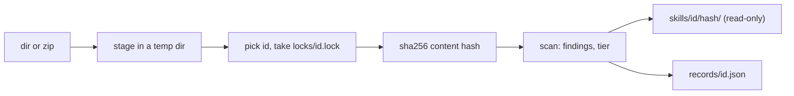

# Store and Risk Tiers

<sub>**English** · [中文](zh/05-store.md)</sub>

`skrun catalog add` copies a skill from elsewhere (another repository, a downloaded zip) into a local store, and `inspect` shows what arrived. Neither executes, builds or imports anything from the skill, and neither reaches the network: the store is where you look at a skill before deciding to install it ([How It Works](04-how-it-works.md)).

```bash
skrun catalog add <dir|zip> [--store <dir>] [--id <id>] [--from <provenance>] [--json]
skrun catalog inspect <id> [--store <dir>] [--json]
skrun catalog inspect --list [--store <dir>] [--json]
```

`add` prints `stored`, `already stored` or `already stored (record refreshed)` with the id, version hash, file and finding counts and the tier; `--json` prints the version record. `inspect` prints each version with its provenance, scripts, findings by severity and tier reasons; `--list` prints one line per id for its newest version (`--json` works there too, though the usage text omits it). Inspecting an id that was never added fails. Every printed string goes through `redact`, also for a record edited by hand.

<sub>Sources: [main.rs:676-771](../crates/skrun/src/main.rs#L676-L771) · [main.rs:858-923](../crates/skrun/src/main.rs#L858-L923) · [store.rs:594-726](../crates/skrun/src/store.rs#L594-L726) · [store.rs:531-583](../crates/skrun/src/store.rs#L531-L583)</sub>

## What add stores



The store root is `--store`, else `$SKRUN_STORE`, else `~/.skrun/store`. The id is `--id`, else the source's own name (the directory name or the zip file stem, taken from the real path, so `add .` works), else the frontmatter `name` with YAML quotes stripped when the source name is not a valid id ([Reference](03-reference.md)). Preferring the source name keeps two authors' skills with the same `name` apart.

The content hash covers every file's path and bytes; a short prefix names the version directory, which is built beside its place and renamed in, so a version never appears half written. `records/<id>.json` lists every version: hash, `--from`, time, file and byte counts, frontmatter name and description, scripts with language and Python imports, findings, tier and reasons. It is written to a temporary file and renamed, under the per-id lock. Adding identical content stores nothing new; only a scan that now differs refreshes that version's scripts, findings and tier.

<sub>Sources: [store.rs:300-321](../crates/skrun/src/store.rs#L300-L321) · [store.rs:323-487](../crates/skrun/src/store.rs#L323-L487) · [store.rs:489-520](../crates/skrun/src/store.rs#L489-L520) · [store.rs:746-825](../crates/skrun/src/store.rs#L746-L825) · [store.rs:1092-1114](../crates/skrun/src/store.rs#L1092-L1114) · +3</sub>

## What add refuses

The source is staged in a fresh temporary directory before anything else, and a refused source never reaches the store. `add` fails on:

- a source that is itself a symlink. Symlinks inside a directory are never followed or copied; each becomes a `symlink` finding instead;
- a source, file or zip entry name that is not UTF-8;
- a zip entry with an absolute path or a path that leaves the archive root, a symlink entry, more than 5,000 entries, more than 50 MB uncompressed, or an entry compressed more than 100 times;
- no `SKILL.md` at the top level or inside a single top-level folder (so a zip of a repository folder works);
- an id that fails the id rules, or another `add` holding the same id's lock for 10 seconds.

A directory copy skips `.git`, `.venv`, `__pycache__`, `node_modules` and `target` folders, so they are neither stored nor hashed.

<sub>Sources: [store.rs:59-87](../crates/skrun/src/store.rs#L59-L87) · [store.rs:827-849](../crates/skrun/src/store.rs#L827-L849) · [store.rs:870-955](../crates/skrun/src/store.rs#L870-L955) · [store.rs:957-1090](../crates/skrun/src/store.rs#L957-L1090) · [store.rs:1566-1584](../crates/skrun/src/store.rs#L1566-L1584)</sub>

## Risk rules

`scan_skill` reads every stored file as lossy UTF-8 text; each rule reports its first match per file as `path:line`. Binary and very large files skip the pattern rules, not the secret check.

| severity | rule | finds |
|---|---|---|
| high | `remote_exec` | curl or wget piped into a shell or Python; `iex`, `Invoke-Expression`, `DownloadString` |
| high | `decode_exec` | a decode call (`b64decode`, `fromhex`, `atob`, `Buffer.from` with base64, …) followed within 160 characters by exec, eval, compile or sh |
| high | `reverse_shell`, `cred_theft`, `exfil_endpoint`, `persistence`, `av_evasion` | /dev/tcp and nc -e; SSH keys, AWS credentials, Keychain, browser cookies, named wallets; webhook or paste services and URLs to public IPv4 hosts; cron, LaunchAgents, shell rc files; quarantine, Gatekeeper, SIP or Defender bypass |
| high | `binary` | a binary extension or magic number (ELF, Mach-O, PE) |
| medium | `obfuscation` | long base64 or hex-escape runs, many `_0x` identifiers |
| medium | `social_engineering` | Markdown and text files only: copy/paste into a terminal, password-protected archives |
| medium | `secret`, `symlink`, `shadows_stdlib` | the secret patterns of [Reference](03-reference.md); a skipped symlink; a Python file or package named after a risky module (below) |

Known gap: in JavaScript, a comment inside the `Buffer.from(...)` arguments hides a `decode_exec`.

<sub>Sources: [risk.rs:377-480](../crates/skrun/src/risk.rs#L377-L480) · [risk.rs:492-550](../crates/skrun/src/risk.rs#L492-L550) · [risk.rs:616-685](../crates/skrun/src/risk.rs#L616-L685) · [risk.rs:722-805](../crates/skrun/src/risk.rs#L722-L805) · [store.rs:1134-1218](../crates/skrun/src/store.rs#L1134-L1218) · +3</sub>

## The suggested tier

`suggest_tier` gives each version a `tier` and `tier_reasons` from the first row that applies:

| tier | when | meant to run in |
|---|---|---|
| `L3` | any high finding | a microVM, never outside one |
| `L2` | a non-Python script (shell, JavaScript, TypeScript), a third-party import, or a risky stdlib import (`subprocess`, `socket`, `urllib`, `http`, `threading`, …) | a container |
| `L1` | a filesystem import (`os`, `pathlib`, `shutil`, `io`, …) or an `open(` call | a sandbox |
| `L0` | Python scripts that only compute | a plain process |
| `none` | no scripts | nothing to run |

A Python import is third-party unless it is in CPython 3.14's `sys.stdlib_module_names` or a local module: a `.py` file, or a folder holding one, in the script's folder or any folder above it up to the skill root. Risky modules are never local, so bundling a `subprocess.py` cannot lower the tier; it is a `shadows_stdlib` finding instead. Only Python imports are parsed; other languages go to `L2` by language.

The tier is a recorded suggestion: skrun has no sandbox yet, and nothing reads the tier back.

<sub>Sources: [store.rs:126-146](../crates/skrun/src/store.rs#L126-L146) · [store.rs:1353-1429](../crates/skrun/src/store.rs#L1353-L1429) · [store.rs:1220-1291](../crates/skrun/src/store.rs#L1220-L1291) · [risk.rs:43-47](../crates/skrun/src/risk.rs#L43-L47) · [risk.rs:347-376](../crates/skrun/src/risk.rs#L347-L376) · +1</sub>
