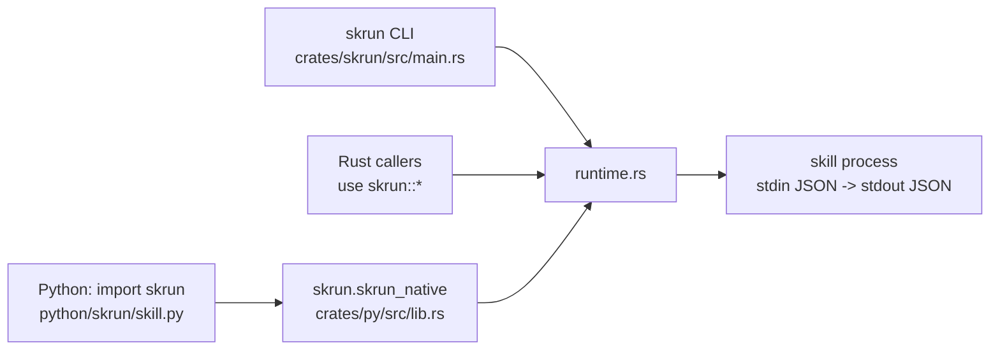
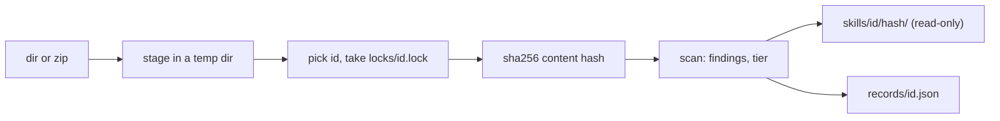

# skrun

<sub>**English** · [中文](zh/all.md)</sub>

These docs explain skrun for developers who want to package local tools as executable skills and call them from an agent framework. They cover what a skill artifact is, how to scaffold, build, install and run one from the CLI or Python, the exact manifest fields, flags and environment variables, how the Rust runtime enforces the stdio JSON contract, and how to work on the repository itself. The README gives the elevator pitch; these pages go one level deeper and are written from the code.

<a id="overview"></a>

## Overview

skrun is a small local runtime for *skills*: directories that package either guidance text (`SKILL.md`) or an executable program behind a fixed JSON contract. It scaffolds, builds, installs and runs those directories, so an agent framework you already use (LangChain, LangGraph, PydanticAI, OpenAI Agents) can call a Rust binary or a uv-managed Python script as an ordinary function that takes a dict and returns a dict.

It deliberately does not plan, chat, store state or manage credentials: the runtime module lists those as things it must not own. You keep your agent loop; skrun is the part that turns "a tool on disk" into "one JSON in, one JSON object out".

Start with [Getting Started](#getting-started), look up exact names in [Reference](#reference), and read [How It Works](#how-it-works) for how a call is executed.

<sub>Sources: [runtime.rs:1-37](../crates/skrun/src/runtime.rs#L1-L37) · [README.md:11-19](../README.md#L11-L19)</sub>

### Three kinds of skill

Every skill directory has a `kind` (`ArtifactKind`):

| kind | what it is | how it runs |
|---|---|---|
| `markdown` | guidance only, usually just `SKILL.md` | never; listed and shown, refused by `build` and `run` |
| `rust_binary` | a Cargo project | the built executable at `entry` |
| `python_uv` | a uv project | `uv run --project <dir> python <entry>` |

`SkillArtifact::validate` ties `executable` to the kind: markdown skills must have `executable: false`, the other two must be executable and must name an `entry` and use the `stdio-json` transport. This is why one directory format can serve both prompt-style skills and real programs.

<sub>Sources: [runtime.rs:55-61](../crates/skrun/src/runtime.rs#L55-L61) · [runtime.rs:206-241](../crates/skrun/src/runtime.rs#L206-L241)</sub>

### One runtime, three front doors

Skill behaviour lives in one Rust module, `crates/skrun/src/runtime.rs`; `catalog` only does bookkeeping for a directory of guidance skills ([Reference](#reference)), and `store` with `risk` copies external skills into a local store and scans them without running them ([Store and Risk Tiers](#store)). The `skrun` crate re-exports the runtime as a library and also ships the `skrun` CLI binary. Python reaches the same code through `skrun-native` (`crates/py`), a PyO3 extension that maturin installs as `skrun.skrun_native`; the pure-Python `skrun` package only converts arguments and JSON.



Because the Python package has no subprocess fallback, a Python call and a CLI call validate and execute a skill identically.

<sub>Sources: [lib.rs:1-16](../crates/skrun/src/lib.rs#L1-L16) · [lib.rs:103-129](../crates/py/src/lib.rs#L103-L129) · [skill.py:295-321](../python/skrun/skill.py#L295-L321) · [pyproject.toml:38-44](../pyproject.toml#L38-L44)</sub>

### Why the workspace is this small

skrun grew out of a larger agent project. Until October 2026 the workspace still carried fourteen crates of that old agent core (agent, chat, engine, server, store and others) plus duplicate copies of the runtime and CLI in `crates/runtime` and `crates/cli`. None of them were used by a published surface, so commit `b6a4feb` removed them, kept only `crates/skrun` and `crates/py`, and pointed the PyO3 module straight at `skrun`. Earlier, `b4c1afe` had already made `skrun` self-contained so it can be published to crates.io without internal workspace crates. The result is one runtime crate and one binding crate.

<sub>Sources: [commit b6a4feb](https://github.com/lhwzds/skrun/commit/b6a4feb) · [commit b4c1afe](https://github.com/lhwzds/skrun/commit/b4c1afe)</sub>

<a id="getting-started"></a>

## Getting Started

You need a Rust toolchain to build `rust_binary` skills, [uv](https://docs.astral.sh/uv/) to build and run `python_uv` skills, and Python 3.11 or newer for the Python package. By default skrun invokes the plain commands `cargo` and `uv`, so both must be on your PATH.

<sub>Sources: [runtime.rs:313-337](../crates/skrun/src/runtime.rs#L313-L337) · [pyproject.toml:6-8](../pyproject.toml#L6-L8)</sub>

### Install

```bash
pip install skrun                 # Python SDK with the native extension
cargo install skrun               # the `skrun` CLI from crates.io
cargo install --path crates/skrun # or: the CLI from a checkout
```

Both packages are published: PyPI has `skrun` 0.1.0 and crates.io has `skrun` 0.1.1 (why the versions differ: [Contributing](#contributing)). The PyPI job runs on `ubuntu-22.04` with Python 3.13, so the published binary wheel targets that platform; elsewhere pip falls back to the sdist and needs Rust plus maturin to compile `skrun-native`. To work from a checkout instead, see [Contributing](#contributing).

<sub>Sources: [Cargo.toml:1-15](../crates/skrun/Cargo.toml#L1-L15) · [publish-python.yml:22](../.github/workflows/publish-python.yml#L22) · [publish-python.yml:34-37](../.github/workflows/publish-python.yml#L34-L37)</sub>

### Create, build and run a skill

```bash
skrun skill new --kind rust_binary --id rust-echo /tmp/rust-echo
skrun skill build /tmp/rust-echo
skrun skill run --input '{"ok":true}' /tmp/rust-echo
# {
#   "ok": true
# }
```

`new` writes a standalone Cargo project (`Cargo.toml` with an empty `[workspace]`, `src/main.rs` that echoes stdin), permissive `schema/input.json` and `schema/output.json`, a `SKILL.md`, and `artifact.json` with `entry: bin/release/rust-echo`. `build` runs Cargo and copies the binary to that `entry` path. `run` pipes the input to the binary and pretty-prints the JSON object it returns.

For Python, use `--kind python_uv`: the scaffold is a `pyproject.toml` plus an echoing `skill.py`, and `build` runs `uv lock`/`uv sync`.

<sub>Sources: [runtime.rs:623-659](../crates/skrun/src/runtime.rs#L623-L659) · [runtime.rs:828-866](../crates/skrun/src/runtime.rs#L828-L866) · [runtime.rs:954-992](../crates/skrun/src/runtime.rs#L954-L992) · [main.rs:123-131](../crates/skrun/src/main.rs#L123-L131)</sub>

### Install it and call it from Python

`install-local` copies a skill directory into the skills root (`~/.skrun/skills` by default; see [Reference](#reference)):

```bash
skrun skill install-local /tmp/rust-echo
skrun skill list
skrun skill run --id rust-echo --input '{"ok":true}'
```

```python
import skrun

skrun.skill("rust-echo").call({"ok": True})        # by id, from the skills root
skrun.skill("/tmp/rust-echo").call({"ok": True})   # or by path
```

`skrun.skill` treats its argument as a path when that directory contains `artifact.json` or `SKILL.md`, otherwise as an id under the skills root. Because install copies, re-install with `--overwrite` after rebuilding a skill ([How It Works](#how-it-works)).

<sub>Sources: [main.rs:132-157](../crates/skrun/src/main.rs#L132-L157) · [skill.py:236-240](../python/skrun/skill.py#L236-L240)</sub>

### Try a real example

`examples/skills` holds `rust-echo`, `python-echo`, `regex-finder` (Rust `regex` crate) and `cdp-browser` (Chrome DevTools Protocol control). The two larger ones show how an existing command-line tool becomes a skill by adding `artifact.json` and JSON schemas, and each ships a `smoke.json` input:

```bash
skrun skill build examples/skills/regex-finder
skrun skill run --input "$(cat examples/skills/regex-finder/smoke.json)" examples/skills/regex-finder
```

`regex-finder` expects `{"action": "match", "input": {"pattern": ..., "text": ...}}` (or `"action": "describe"`) and answers with an `ok`/`action`/`data`/`error` envelope. Building writes `bin/release/regex-finder` inside the example directory.

<sub>Sources: [artifact.json](../examples/skills/regex-finder/artifact.json) · [smoke.json](../examples/skills/regex-finder/smoke.json) · [main.rs:91-117](../examples/skills/regex-finder/src/main.rs#L91-L117) · [release-skills.yml:75-82](../.github/workflows/release-skills.yml#L75-L82)</sub>

### Call a skill from an agent framework

skrun has no framework adapters; a tool body is one line, and the framework's own decorator or wrapper supplies the tool schema:

```python
import skrun

def regex_finder_tool(pattern: str, text: str) -> dict:
    return skrun.skill("regex-finder").call(
        {"action": "match", "input": {"pattern": pattern, "text": text}}
    )
```

`examples/frameworks` has the same shape for LangChain, LangGraph, PydanticAI and OpenAI Agents. The LangChain example passes the tool's `arguments` dict through unchanged. The other three build `{"pattern": ..., "path": ...}`, which `regex-finder` rejects because it requires `text`; use the input shape above. `schema/input.json` in each skill is the natural source for the framework's parameter schema. Errors surface as `SkillRuntimeError`, which most frameworks report back to the model.

<sub>Sources: [langchain_tool.py:15-18](../examples/frameworks/langchain_tool.py#L15-L18) · [langgraph_node.py:10-19](../examples/frameworks/langgraph_node.py#L10-L19) · [main.rs:91-117](../examples/skills/regex-finder/src/main.rs#L91-L117) · [input.json](../examples/skills/regex-finder/schema/input.json) · [skill.py:172-173](../python/skrun/skill.py#L172-L173) · +2</sub>

<a id="reference"></a>

## Reference

Exact names for the CLI, environment, file formats and Python API, copied from the code. `skrun`, `skrun -h`, `skrun --help` and `skrun help` print the usage text.

<sub>Sources: [main.rs:337-340](../crates/skrun/src/main.rs#L337-L340) · [main.rs:1004-1023](../crates/skrun/src/main.rs#L1004-L1023)</sub>

### CLI commands and flags

Skill commands live under `skrun skill`; `skrun catalog` is below. Positional `<dir>` / `<id>` may appear anywhere among the flags.

| command | flags (default) |
|---|---|
| `new <dir>` | `--kind markdown\|guidance\|rust_binary\|python_uv` (required), `--id` (required), `--name` (title-cased id: `regex-finder` → `Regex Finder`), `--version` (`0.1.0`) |
| `build <dir>` | `--profile` (`release`), `--target-dir`, `--cargo` (`cargo`), `--uv` (`uv`) |
| `run <dir>` or `run --id <id>` | `--input` (`{}`; must be a JSON object), `--timeout` seconds (`60`), `--uv` (`uv`), `--root` (with `--id` only) |
| `install-local <dir>` | `--root`, `--id` (rename on install), `--overwrite` |
| `list` | `--root`, `--format text\|json` (`text`) |
| `show <id>` | `--root`, `--format text\|json` (`text`) |

`--root` defaults to the skills root (below). `list` and `show` print tab-separated `id kind version name`. `run` rejects a directory plus `--id`. `--cargo` and `--uv` are missing from the usage text. Errors print `Error: ...` to stderr and exit 1, or 2 for a usage error (unknown, missing or invalid argument); echoed arguments and paths that look like a secret print as `<redacted>`.

<sub>Sources: [main.rs:49-66](../crates/skrun/src/main.rs#L49-L66) · [main.rs:364-395](../crates/skrun/src/main.rs#L364-L395) · [main.rs:397-468](../crates/skrun/src/main.rs#L397-L468) · [main.rs:470-537](../crates/skrun/src/main.rs#L470-L537) · [main.rs:939-968](../crates/skrun/src/main.rs#L939-L968) · +1</sub>

### Catalog commands

`skrun catalog` works on a directory of guidance skills: non-hidden subdirectories with a `SKILL.md`, plus top-level `*.md` except `SKILL_REGISTRY.md`, `README.md`, `README_CN.md`, `AGENTS.md` and `CLAUDE.md`. Its `add` and `inspect` work on the store instead ([Store and Risk Tiers](#store)).

| command | flags (default) | exits 1 when |
|---|---|---|
| `index <dir>` | `--out <file>` (stdout) | the directory cannot be read |
| `registry <dir>` | `--registry` (`<dir>/SKILL_REGISTRY.md`), `--write` | without `--write`, the table drifted; always, the file is missing, has no table, or cannot be read or written |
| `check <dir>` | `--registry`, `--index` | any error |
| `search <dir> <query>...` | `--kind folder\|flat`, `--has-scripts`, `--limit` (`10`), `--json` | nothing matches (`--json` prints `[]`) |

`check` errors on: a folder skill missing frontmatter `name` or `description`, a broken relative link, a missing or drifted registry table, a stale `skills.json`, and a line holding a secret. Its one warning: a frontmatter `name` differing from the directory name.

Secrets are private-key blocks, tokens starting `AKIA`, `sk-` (incl. `sk-proj-`, `sk-ant-`), `gh[pousr]_`, `github_pat_`, `glpat-`, `xox[baprs]-` or `AIza`, and generic assignments such as `password: …` ([Store and Risk Tiers](#store)). `check`, `registry` and `search` print matching user text as `<redacted>` (`redact`); a secret finding gives only `path:line`. `skills.json` keeps real paths ([How It Works](#how-it-works)).

<sub>Sources: [main.rs:173-211](../crates/skrun/src/main.rs#L173-L211) · [main.rs:783-856](../crates/skrun/src/main.rs#L783-L856) · [main.rs:539-771](../crates/skrun/src/main.rs#L539-L771) · [catalog.rs:66-72](../crates/skrun/src/catalog.rs#L66-L72) · [catalog.rs:373-420](../crates/skrun/src/catalog.rs#L373-L420) · +6</sub>

### Environment and default paths

| name | effect |
|---|---|
| `SKRUN_SKILLS_DIR` | skills root used by `run --id`, `install-local`, `list`, `show` and the Python SDK |
| `HOME` | fallback root `$HOME/.skrun/skills`; the CLI and Rust callers fail with `HOME is not set` if neither is set |
| `SKRUN_STORE` | store of `catalog add` and `inspect` when `--store` is absent, else `$HOME/.skrun/store` ([Store and Risk Tiers](#store)) |

The CLI computes this default eagerly (`root.unwrap_or(default_skills_dir()?)`), so with neither variable set, `run --id`, `install-local`, `list` and `show` fail with `HOME is not set` even when `--root` is given.

`build` of a `rust_binary` uses `<system temp dir>/skrun-skill-targets/<id>` as Cargo's target directory unless `--target-dir` is given, so skill builds leave no Cargo target directory in the skill directory. The Python SDK resolves the same root itself (expanding `~`), and passes its `root=` argument through when you set one.

<sub>Sources: [runtime.rs:50-53](../crates/skrun/src/runtime.rs#L50-L53) · [runtime.rs:719-725](../crates/skrun/src/runtime.rs#L719-L725) · [runtime.rs:954-959](../crates/skrun/src/runtime.rs#L954-L959) · [skill.py:242-248](../python/skrun/skill.py#L242-L248) · [main.rs:455-463](../crates/skrun/src/main.rs#L455-L463) · +4</sub>

### artifact.json

`artifact.json` deserializes into `SkillArtifact`. Unknown keys are ignored.

| field | required | notes |
|---|---|---|
| `schema_version` | yes | must be `1` |
| `kind` | yes | `markdown`, `rust_binary`, `python_uv` |
| `id`, `name`, `version` | yes | strings; `id` is validated (below) |
| `executable` | no, default `true` | must be `false` for `markdown` |
| `entry` | for executable kinds | relative path to the binary or Python script |
| `protocol` | no | `transport`, `input`, `output`; default `stdio-json`, `single-json-value`, `single-json-value`. Only `transport` is checked. |
| `schema` | no | `input`, `output`: relative paths to JSON Schema files |
| `description`, `tags`, `suggested_tools`, `content`, `source_ref` | no | metadata; filled from `SKILL.md` when absent |
| `source` | no | `{"type": ..., "ref": ...}` provenance, e.g. `"type": "git"` |

The schema files are documentation for callers: for executable kinds the runtime checks that their paths are relative, but it never validates input or output against them.

<sub>Sources: [runtime.rs:63-123](../crates/skrun/src/runtime.rs#L63-L123) · [runtime.rs:252-254](../crates/skrun/src/runtime.rs#L252-L254) · [runtime.rs:214-238](../crates/skrun/src/runtime.rs#L214-L238)</sub>

### SKILL.md frontmatter

`SKILL.md` may start with a `---` block. skrun reads only these keys, with a minimal line parser rather than full YAML:

- `name`, `description`, `version`
- `source_ref` (alias `ref`)
- `tags`, `suggested_tools`: inline `[a, b]` / `a, b`, or a following `- item` list

Quotes around values are stripped; every other key (the examples' `id:` and `kind:` included) is ignored. The text after the block becomes `content`. For a directory with only `SKILL.md`, the id is the directory name, the name falls back to the first `# ` heading and then to the title-cased id, and the version defaults to `0.1.0`.

<sub>Sources: [runtime.rs:458-563](../crates/skrun/src/runtime.rs#L458-L563) · [runtime.rs:392-425](../crates/skrun/src/runtime.rs#L392-L425)</sub>

### Id and path rules

An id must be non-empty, contain only ASCII letters, digits, `-` and `_`, and start with a letter or digit. The same check applies to `--id` on `install-local`, so an installed directory name is always a safe single path segment.

For the executable kinds (`rust_binary`, `python_uv`), `entry`, `schema.input` and `schema.output` must be non-empty relative paths with no `..` or root components: the check is lexical, so a symlink inside the directory can still resolve outside it. A `markdown` artifact's `schema.*` paths are not checked.

<sub>Sources: [runtime.rs:789-826](../crates/skrun/src/runtime.rs#L789-L826) · [runtime.rs:206-241](../crates/skrun/src/runtime.rs#L206-L241)</sub>

### Python API

| call | returns |
|---|---|
| `skrun.skill(id_or_path, root=None)` | `SkillHandle` (loads and validates the artifact) |
| `SkillHandle.call(value=None, timeout=60.0)` | the skill's output `dict` |
| `skrun.list_skills(root=None)` | `list[SkillArtifact]` |
| `skrun.install_local_skill(source, root=None, *, skill_id=None, overwrite=False)` | `SkillHandle` looked up by the installed manifest's id |
| `skrun.build_skill(root, target_dir=None)` | `SkillArtifact` |
| `skrun.load_artifact(root)` | `SkillArtifact` |

`SkillRuntime(root=..., uv=...)` groups the same operations around one skills root. Every failure, including a missing native extension, raises `SkillRuntimeError`. Two details differ from the CLI: `timeout` is truncated to whole seconds, and the `uv` field on `SkillRuntime`/`SkillHandle` is stored but not passed to the native call, so Python skills always run the `uv` found on PATH.

Known issue: `install_local` returns `self.skill(artifact.id)`. When `skill_id=` renames a skill that has `artifact.json`, the copy keeps the manifest's id, so the handle resolves `<root>/<original id>`, not the copy. Look it up with `skrun.skill(skill_id, root=...)`.

<sub>Sources: [__init__.py:7-35](../python/skrun/__init__.py#L7-L35) · [skill.py:172-234](../python/skrun/skill.py#L172-L234) · [skill.py:251-292](../python/skrun/skill.py#L251-L292)</sub>

<a id="how-it-works"></a>

## How It Works

Every operation starts the same way: `load_artifact` reads the skill directory into a validated `SkillArtifact`. `build_skill` and `run_skill` then dispatch on its `kind`; `install_local_skill` copies the directory, skipping `.venv` and build caches. There is no daemon, cache or registry; the filesystem is the only state.

<sub>Sources: [runtime.rs:594-609](../crates/skrun/src/runtime.rs#L594-L609)</sub>

### Loading a skill directory

If `artifact.json` exists, it is decoded and then `apply_skill_markdown` fills only the metadata fields the manifest left empty (`description`, `tags`, `suggested_tools`, `content`, `source_ref`) from `SKILL.md`. The manifest always wins. Without `artifact.json`, the directory must contain `SKILL.md` and becomes a `markdown` skill named after the directory. Either way `validate` runs last, so every caller — CLI, Rust library, Python — sees the same errors for a bad manifest.

<sub>Sources: [runtime.rs:594-609](../crates/skrun/src/runtime.rs#L594-L609) · [runtime.rs:427-447](../crates/skrun/src/runtime.rs#L427-L447) · [runtime.rs:392-425](../crates/skrun/src/runtime.rs#L392-L425)</sub>

### How a call runs

```mermaid
sequenceDiagram
  participant C as caller
  participant R as run_skill
  participant P as skill process
  C->>R: dir, JSON value, RunOptions
  R->>R: canonicalize dir, load_artifact
  R->>P: spawn in dir (rust: entry binary / python: uv run --project dir python entry)
  R->>P: stdin = JSON + "\n", then close
  loop every 10 ms until exit or timeout
    R->>P: try_wait
  end
  P-->>R: exit status, stdout, stderr
  R->>R: non-zero exit -> error; stdout must parse as a JSON object
  R-->>C: SkillRunOutput { value, stderr, exit_code }
```

The working directory is the skill directory, so a skill can open its own files by relative path. Closing stdin after one value is what lets a skill simply read to EOF. Stderr is captured and returned as diagnostics, never parsed.

<sub>Sources: [runtime.rs:675-717](../crates/skrun/src/runtime.rs#L675-L717) · [runtime.rs:1006-1069](../crates/skrun/src/runtime.rs#L1006-L1069)</sub>

### What counts as failure

- **Timeout**: after `timeout` (60 s by default) the process is killed and the call fails with `skill process timed out after Ns`.
- **Non-zero exit**: the call fails with the exit code and trimmed stderr. Stdout is discarded, so a skill that prints a structured error body and exits 1 (as `regex-finder` does) loses that body; put the message on stderr too, or exit 0 with `"ok": false`.
- **Bad output**: stdout must be exactly one JSON value and it must be an object; arrays, scalars or several JSON values are errors (one object spread over many lines is fine).

Stdout and stderr are only collected after the process exits. Untested, from the code: a skill that writes more than the OS pipe buffer before exiting blocks until the timeout; write large results to a file and return its path.

<sub>Sources: [runtime.rs:1027-1069](../crates/skrun/src/runtime.rs#L1027-L1069) · [main.rs:27-35](../examples/skills/regex-finder/src/main.rs#L27-L35)</sub>

### Builds

`rust_binary`: run `cargo build --manifest-path <dir>/Cargo.toml --target-dir <target>` with `--release` when the profile is `release`, otherwise `--profile <name>`, then copy `<target>/<dir>/<id>` (plus the platform exe suffix) to `entry`, where `<dir>` is Cargo's output directory: `debug` for `dev` and `test`, `release` for `release` and `bench`, otherwise the profile name. The binary name must therefore equal the skill id. The copy goes to `entry` whatever the profile, so a debug build still lands in `bin/release/...` with the scaffolded entry.

`python_uv`: run `uv lock --project <dir>` only when `uv.lock` is missing, then `uv sync --project <dir> --locked`. The lock file is part of the skill, so installs are reproducible.

Both build steps capture output and report only stderr on failure. `markdown` skills cannot be built.

<sub>Sources: [runtime.rs:661-673](../crates/skrun/src/runtime.rs#L661-L673) · [runtime.rs:946-992](../crates/skrun/src/runtime.rs#L946-L992) · [runtime.rs:1071-1083](../crates/skrun/src/runtime.rs#L1071-L1083)</sub>

### Install and list

`install_local_skill` validates the source, then recursively copies it to `<root>/<id>`. An existing target fails with `installed skill already exists` unless `overwrite` is set; with `overwrite`, the target is deleted first, and installing a directory onto itself returns early without copying. The copy is re-loaded and returned; only metadata is checked, so an unbuilt Rust skill installs fine and fails when run. Built binaries are copied, but directories named `.venv`, `__pycache__`, `target` or `.git` are skipped at any depth unless the artifact's `entry` lies inside one. Renaming with `--id` changes only the directory name; the copied `artifact.json` keeps its original `id`.

`list_installed_skills` scans the root's direct subdirectories that hold `artifact.json` or `SKILL.md`, skips those that fail to load, and sorts by id. A missing root lists as empty.

<sub>Sources: [runtime.rs:727-787](../crates/skrun/src/runtime.rs#L727-L787) · [runtime.rs:1096-1113](../crates/skrun/src/runtime.rs#L1096-L1113) · [runtime.rs:760-766](../crates/skrun/src/runtime.rs#L760-L766)</sub>

### The Python boundary

`skrun-native` exposes five functions (`runtime_load_artifact_json`, `runtime_list_skills_json`, `runtime_build_skill_json`, `runtime_run_skill_json`, `runtime_install_local_skill_json`). Each takes strings and returns a JSON string that the Python dataclasses mirror. Each call runs inside `py.detach`, which releases the GIL while a build or skill process runs. Rust errors become `RuntimeError` and the SDK rewraps them as `SkillRuntimeError`. For list and install, an empty or missing `root` falls back to `default_skills_dir`; load, build and run need an explicit `root`. Builds from Python always use the default Cargo/uv commands and release profile; only `target_dir` is configurable.

<sub>Sources: [lib.rs:39-151](../crates/py/src/lib.rs#L39-L151) · [skill.py:316-331](../python/skrun/skill.py#L316-L331)</sub>

### Why catalog output is deterministic

`catalog` never runs skills, git or network calls; only `registry --write`, `index --out` and `add` write. `build_index` sorts skills by id and scripts by path, without timestamps or absolute paths. Per skill: frontmatter, entrypoint `bytes`, scripts (`.py`, `.sh`, `.js`/`.mjs`, `.ts`; Python imports) and relative links with whether each exists. Same input, same `skills.json`, so `check` flags a stale copy. Nothing is redacted: review it before committing.

`reconcile_registry` edits only the `| Skill | When to read | Entrypoint |` table of the curated `SKILL_REGISTRY.md`, outside fenced code (backtick or `~~~`, closed only in the opening container: top level, list item or quote; a backticked info string means inline code). Valid rows stay verbatim and ordered; rows with a missing, non-skill or repeated entrypoint go; unlisted skills get `| name | summary | [id](entrypoint) |` (description's first sentence, ≤160 characters). Cells honour `\|` and `\\`; paths with parentheses, spaces, `<` or `>` use `[id](<path>)`. Separators, other lines and endings stay; with no table it fails unwritten. Known gaps: ordered-list fences closed at 4+ spaces stay open (`registry` then finds no table), reversed list/quote nesting may close one early, `>` paths don't round-trip.

<sub>Sources: [catalog.rs:14-18](../crates/skrun/src/catalog.rs#L14-L18) · [catalog.rs:423-455](../crates/skrun/src/catalog.rs#L423-L455) · [catalog.rs:484-588](../crates/skrun/src/catalog.rs#L484-L588) · [catalog.rs:3592-3635](../crates/skrun/src/catalog.rs#L3592-L3635) · [catalog.rs:1335-1379](../crates/skrun/src/catalog.rs#L1335-L1379) · +6</sub>

### How search ranks

`search_skills` lowercases each whitespace-separated term and matches it as a substring, so Chinese needs no segmentation. Every term must hit a field (AND) and adds the weight of each field it hits: id 5, frontmatter name 4, registry title 4, registry summary, description and each tag 3, entrypoint body 1. Results sort by score, then id; `--has-scripts` drops flat skills. A result shows the registry title (else the name) and the registry summary (else the description's first sentence: up to `. `, `? `, `! `, `。`, `？`, `！` or a newline, ≤120 characters), redacted before the cut so a secret never prints in part.

<sub>Sources: [catalog.rs:717-741](../crates/skrun/src/catalog.rs#L717-L741) · [catalog.rs:788-864](../crates/skrun/src/catalog.rs#L788-L864) · [catalog.rs:904-958](../crates/skrun/src/catalog.rs#L904-L958) · [catalog.rs:1016-1054](../crates/skrun/src/catalog.rs#L1016-L1054) · [catalog.rs:78-90](../crates/skrun/src/catalog.rs#L78-L90)</sub>

<a id="store"></a>

## Store and Risk Tiers

`skrun catalog add` copies a skill from elsewhere (another repository, a downloaded zip) into a local store; `inspect` shows what arrived. Neither executes, builds or imports anything from the skill, nor reaches the network: the store is where you look before installing ([How It Works](#how-it-works)).

```bash
skrun catalog add <dir|zip> [--store <dir>] [--id <id>] [--from <provenance>] [--json]
skrun catalog inspect <id> [--store <dir>] [--json]
skrun catalog inspect --list [--store <dir>] [--json]
```

`add` prints `stored`, `already stored` or `already stored (record refreshed)` with id, version hash, file and finding counts and tier; `--json` prints the version record. `inspect` prints each version's provenance, scripts, findings by severity and tier reasons; `--list` prints each id's newest version on one line. Every printed string goes through `redact`, even from a hand-edited record.

<sub>Sources: [main.rs:676-771](../crates/skrun/src/main.rs#L676-L771) · [main.rs:858-923](../crates/skrun/src/main.rs#L858-L923) · [store.rs:646-785](../crates/skrun/src/store.rs#L646-L785) · [store.rs:583-635](../crates/skrun/src/store.rs#L583-L635)</sub>

### What add stores



The id is `--id`, else the source's name (directory or zip stem, from the real path, so `add .` works), else the unquoted frontmatter `name` if that is not a valid id ([Reference](#reference)). Two sources with the same name become versions of one id unless `--id` separates them.

`records/<id>.json` lists each version: hash, `--from`, time, file and byte counts, frontmatter name and description, scripts with language and imports, findings, tier and reasons. It is written atomically under the per-id lock. Identical content stores nothing new; a scan that now differs refreshes that version's scripts, findings and tier.

<sub>Sources: [store.rs:363-539](../crates/skrun/src/store.rs#L363-L539) · [store.rs:805-895](../crates/skrun/src/store.rs#L805-L895) · [store.rs:2037-2097](../crates/skrun/src/store.rs#L2037-L2097) · [catalog.rs:1208-1233](../crates/skrun/src/catalog.rs#L1208-L1233)</sub>

### Version hashes and file modes

`content_hash` feeds sha256, per file in path order, the path length as a big-endian u64, the path, the content length, then the content, so different file sets never share a hash. Its first 16 hex characters name the version directory; if that directory holds other content, `version_name` uses 32, then 64, so different content is never taken as already stored.

A version is copied beside its place and renamed in, never half written. Store directories are `0700`, stored files `0400` and their directories `0500`, records `0600`.

<sub>Sources: [store.rs:82-107](../crates/skrun/src/store.rs#L82-L107) · [store.rs:541-572](../crates/skrun/src/store.rs#L541-L572) · [store.rs:828-837](../crates/skrun/src/store.rs#L828-L837) · [store.rs:1264-1328](../crates/skrun/src/store.rs#L1264-L1328) · [store.rs:1856-1886](../crates/skrun/src/store.rs#L1856-L1886)</sub>

### What add refuses

The source is staged in a fresh temporary directory first; a refused source never reaches the store. `add` fails on:

- a source that is itself a symlink. Symlinks inside a directory are never followed or copied; each becomes a `symlink` finding;
- a source, file or zip entry name that is not UTF-8;
- a zip entry with an absolute path or one leaving the archive root, a symlink entry, more than 5,000 entries, more than 50 MB uncompressed, or an entry compressed over 100 times, counted on the bytes actually written, not just declared sizes;
- no `SKILL.md` at the top level or inside a single top-level folder (so a zip of a repository folder works);
- an invalid id, or another `add` holding the id's lock for 10 seconds.

Directory copies skip `.git`, `.venv`, `__pycache__`, `node_modules` and `target`.

<sub>Sources: [store.rs:73-116](../crates/skrun/src/store.rs#L73-L116) · [store.rs:897-919](../crates/skrun/src/store.rs#L897-L919) · [store.rs:940-1025](../crates/skrun/src/store.rs#L940-L1025) · [store.rs:1027-1262](../crates/skrun/src/store.rs#L1027-L1262) · [store.rs:1952-1970](../crates/skrun/src/store.rs#L1952-L1970)</sub>

### Risk rules

`scan_skill` reads each file as lossy UTF-8; a rule reports its first match per file as `path:line`. Binary files and files over 16 MB (`MAX_SCAN_BYTES`) skip these rules, not the secret check.

| severity | rule | finds |
|---|---|---|
| high | `remote_exec` | curl or wget piped into a shell or Python; `iex`, `Invoke-Expression`, `DownloadString` |
| high | `decode_exec` | a decode call (`b64decode`, `fromhex`, `atob`, base64 `Buffer.from`, …) within 160 characters before exec, eval, compile or sh |
| high | `reverse_shell`, `cred_theft`, `exfil_endpoint`, `persistence`, `av_evasion` | /dev/tcp, nc -e; SSH keys, AWS credentials, Keychain, browser cookies, wallets; webhook or paste services, public IPv4 URLs; cron, LaunchAgents, shell rc files; quarantine, Gatekeeper, SIP or Defender bypass |
| high | `binary` | a binary extension or magic number (ELF, Mach-O, PE) |
| medium | `obfuscation`, `social_engineering` | long base64 or hex-escape runs, many `_0x` identifiers; in Markdown and text, paste-into-terminal or password-protected archive lures |
| medium | `secret`, `symlink`, `unscanned`, `unparsed`, `shadows_stdlib` | a secret; a skipped symlink; a file over 16 MB; untokenisable Python; a `.py`, extensionless file or Python folder named after a stdlib module beside or above a script |

Known gap: a JavaScript comment in `Buffer.from(...)` arguments hides a `decode_exec`.

<sub>Sources: [risk.rs:379-482](../crates/skrun/src/risk.rs#L379-L482) · [risk.rs:494-552](../crates/skrun/src/risk.rs#L494-L552) · [risk.rs:37-43](../crates/skrun/src/risk.rs#L37-L43) · [risk.rs:619-686](../crates/skrun/src/risk.rs#L619-L686) · [risk.rs:725-808](../crates/skrun/src/risk.rs#L725-L808) · +6</sub>

### What counts as a secret

Beyond the tokens of [Reference](#reference), `line_has_secret` flags an assignment (`=` or `:`, quoted keys too) whose key has `password`, `passwd`, `pwd`, `secret`, `token`, `api_key`, `client_secret`, access or private key as a whole word (`x-api-key`, or last segment as in `POSTGRES_PASSWORD`; not `max_tokens`) and whose value looks real: six or more non-space characters, not a `$` or `%` variable, expression, type annotation or placeholder (`<token>`, `changeme`, `YOUR_KEY`, …). Findings give `path:line` only; `redact` prints such strings as `<redacted>`. Known gap: a YAML value starting with a placeholder word, then a real secret.

<sub>Sources: [catalog.rs:2608-2683](../crates/skrun/src/catalog.rs#L2608-L2683) · [catalog.rs:2685-2763](../crates/skrun/src/catalog.rs#L2685-L2763) · [catalog.rs:2786-2890](../crates/skrun/src/catalog.rs#L2786-L2890) · [catalog.rs:2892-2928](../crates/skrun/src/catalog.rs#L2892-L2928) · [commit ae10cbf](https://github.com/lhwzds/skrun/commit/ae10cbf)</sub>

### How scripts and imports are read

A file is a script by extension (`.py`, `.sh`, `.js`/`.mjs`, `.ts`), else by a `#!` line: `sh`, `bash`, `zsh`, `dash` mean shell, `python*` Python, `node`, `deno`, `bun` JavaScript, anything else `other`. Python imports count outside strings and comments, even after `;` or `:` (`if True: import x`), plus `__import__` and `importlib.import_module` with a string literal. Python that cannot be tokenised (unbalanced brackets, unterminated strings, bad indentation) is `unparsed`. Known gap: a triple-quoted module name inside `__import__` is missed.

An import is third-party unless it is in CPython 3.14's `sys.stdlib_module_names` or local: a `.py` file, or a folder holding one, beside the script or above it.

<sub>Sources: [store.rs:1608-1652](../crates/skrun/src/store.rs#L1608-L1652) · [catalog.rs:1335-1394](../crates/skrun/src/catalog.rs#L1335-L1394) · [catalog.rs:1638-1679](../crates/skrun/src/catalog.rs#L1638-L1679) · [catalog.rs:1769-1815](../crates/skrun/src/catalog.rs#L1769-L1815) · [store.rs:1469-1540](../crates/skrun/src/store.rs#L1469-L1540) · +2</sub>

### The suggested tier

`suggest_tier` records the first matching row as `tier`, with `tier_reasons`:

| tier | when | meant to run in |
|---|---|---|
| `L3` | a high finding, an `unscanned` script, or a file shadowing a risky module (`subprocess`, `socket`, `threading`, …) | a microVM |
| `L2` | a non-Python script (shell, JavaScript, TypeScript, `other`), a third-party or risky import, an `unscanned` or `unparsed` file, any `shadows_stdlib` | a container |
| `L1` | a filesystem import (`os`, `pathlib`, `shutil`, `io`, …) or an `open(` call | a sandbox |
| `L0` | Python scripts that only compute | a plain process |
| `none` | no scripts | nothing to run |

A bundled `subprocess.py` raises the tier, never lowers it. The tier is a recorded suggestion: skrun has no sandbox yet, and nothing reads it back.

<sub>Sources: [store.rs:155-175](../crates/skrun/src/store.rs#L155-L175) · [store.rs:1672-1814](../crates/skrun/src/store.rs#L1672-L1814) · [risk.rs:45-49](../crates/skrun/src/risk.rs#L45-L49) · [risk.rs:349-378](../crates/skrun/src/risk.rs#L349-L378) · [risk.rs:869-875](../crates/skrun/src/risk.rs#L869-L875)</sub>

<a id="contributing"></a>

## Contributing

The Cargo workspace has two members: `crates/skrun` (default member: runtime library and CLI) and `crates/py` (`skrun-native`). PyO3 is behind the optional `python-module` feature, so `cargo build` and `cargo test` at the root never need a Python interpreter; only maturin and the native checks enable it. The module map is in [Code structure](#structure).

<sub>Sources: [Cargo.toml:1-17](../Cargo.toml#L1-L17) · [Cargo.toml:13-15](../crates/py/Cargo.toml#L13-L15) · [build.rs](../crates/py/build.rs)</sub>

### Local development loop

```bash
make test     # cargo test + python unittest of python/tests
make lint     # cargo fmt --check + clippy -D warnings
make python   # scripts/check.sh ci: full package loop
make check    # lint + test + python
```

`scripts/check.sh ci` creates a venv, installs maturin, runs the Python contract tests, tests and lints `skrun-native` with `--features python-module`, then `develop`, `smoke`, `build` and `sdist` through `python/scripts/package.py`. Each step is also a subcommand (`bootstrap`, `python`, `rust`, `develop`, `smoke`, `build`, `sdist`). It reads `PYTHON_BIN` (`python3`), `PYTHON_VENV` (`/tmp/skrun-python-venv`), `CARGO_TARGET_DIR` (`/tmp/skrun-python-target`) and `WHEEL_DIR` (`/tmp/skrun-python-dist`). `package.py` sets `PYO3_PYTHON` and `CARGO_TARGET_DIR` itself; the default target lives in `/tmp` so native artifacts are not built or executed from an external macOS volume. `make clean` removes those three `/tmp` paths.

<sub>Sources: [Makefile](../Makefile) · [check.sh:7-13](../scripts/check.sh#L7-L13) · [check.sh:59-89](../scripts/check.sh#L59-L89) · [package.py:13-41](../python/scripts/package.py#L13-L41)</sub>

### What the smoke test proves

`package.py smoke` runs from `/tmp`, so it imports the installed package rather than the source tree. It writes a throwaway `rust_binary` skill whose entry is a `#!/bin/sh` script running `cat`, then asserts that `skrun.skill(root).call({'native': True})` returns the same dict. A shell script is enough because `rust_binary` only requires an executable file at `entry`, which also makes this a quick way to wrap any existing executable for testing.

<sub>Sources: [package.py:64-88](../python/scripts/package.py#L64-L88)</sub>

### CI and releases

| workflow | trigger | does |
|---|---|---|
| `python.yml` | push / PR to `main` touching code | the `check.sh` steps, uploads the wheel |
| `publish-crates.yml` | tag `v*` or manual | `cargo test -p skrun`, dry-run, `cargo publish -p skrun` |
| `publish-python.yml` | tag `v*` or manual | `scripts/check.sh ci`, then PyPI publish (`skip-existing`) |
| `release-skills.yml` | tag `<skill>@<version>` or manual | builds, smoke-runs and attaches `<skill>@<version>-x86_64-linux.tar.gz` (`artifact.json`, `SKILL.md`, `schema`, `bin`) to a GitHub release |

`release-skills.yml` accepts only `regex-finder` and `cdp-browser`, and uses the CLI itself to build and run each example's `smoke.json`. Crates.io and PyPI publishing use trusted publishing (`id-token: write`), not stored tokens. Versions are set separately: the workspace `Cargo.toml` says 0.1.1 (the published crate), while `pyproject.toml` and `python/skrun/__init__.py` say 0.1.0 (the published PyPI package). Bump all three when releasing; `skip-existing` means an unbumped Python version is silently not re-uploaded.

<sub>Sources: [python.yml:1-20](../.github/workflows/python.yml#L1-L20) · [publish-crates.yml:1-52](../.github/workflows/publish-crates.yml#L1-L52) · [publish-python.yml:1-11](../.github/workflows/publish-python.yml#L1-L11) · [publish-python.yml:50-57](../.github/workflows/publish-python.yml#L50-L57) · [release-skills.yml:1-103](../.github/workflows/release-skills.yml#L1-L103) · +3</sub>

### Adding a skill kind or command

A new kind touches every `match` on `ArtifactKind` in `runtime.rs`: `validate`, `scaffold_skill`, `build_skill`, `run_skill` and `kind_label`, plus `parse_kind` and the duplicate `kind_label` in `main.rs`. The Python side treats `kind` as a plain string and needs no change unless the kind needs new options. Keep the runtime contract intact: anything that executes must still take one JSON value on stdin and return one JSON object on stdout.

The runtime, CLI, binding and SDK modules open with a doc header (`Owns`, `Must Not`, `Inputs`, `Outputs`, `Depends On`, `Verify`). Update it when you move responsibility, and respect the `Must Not` lists: the runtime does not plan, parse `@skill` mentions, render UI or hold durable state. New operations belong in `runtime.rs` first and are then exposed through `main.rs` and `crates/py/src/lib.rs`, never implemented in Python.

<sub>Sources: [runtime.rs:55-61](../crates/skrun/src/runtime.rs#L55-L61) · [runtime.rs:586-592](../crates/skrun/src/runtime.rs#L586-L592) · [main.rs:939-968](../crates/skrun/src/main.rs#L939-L968) · [runtime.rs:3-17](../crates/skrun/src/runtime.rs#L3-L17)</sub>

<a id="structure"></a>

## Code structure

Generated by Codocia from the code on every build: areas, each area's own description, import dependencies between areas, and the pages that explain them.

In scope: 53 files, 16,537 lines; excluded `docs/**`, `python/tests/**`, `**/tests/**`, `Cargo.lock`, `.github/dependabot.yml`, `examples/skills/cdp-browser/src/**`, `.gitattributes`, `.gitignore`, `LICENSE`

### Files

**Repository root**

- (root files) — 466 lines, 5 files. skrun executable skill runtime internals.\
  Explained in: [Overview](#overview) (2), [Getting Started](#getting-started) (1), [Contributing](#contributing) (3)
- `.github/` — 313 lines, 4 files\
  Explained in: [Getting Started](#getting-started) (2), [Contributing](#contributing) (1)
- `python/` — 548 lines, 4 files. `skrun` is the Python SDK for the skrun executable skill runtime.\
  Hub files: `skrun/skill.py` `scripts/package.py` `skrun/__init__.py`\
  Explained in: [Overview](#overview) (1), [Getting Started](#getting-started) (2), [Reference](#reference) (2), [How It Works](#how-it-works) (1), [Contributing](#contributing) (3)
- `scripts/` — 124 lines, 1 file\
  Hub files: `check.sh`\
  Explained in: [Contributing](#contributing) (1)

**`crates/`**

- `py/` — 269 lines, 3 files. PyO3 module boundary for the skrun executable skill runtime.\
  Hub files: `src/lib.rs` `build.rs`\
  Explained in: [Overview](#overview) (1), [How It Works](#how-it-works) (1), [Contributing](#contributing) (1)

**`crates/skrun/`**

- (files) — 23 lines, 1 file. Public API for the skrun executable skill runtime.\
  Explained in: [Getting Started](#getting-started) (1)
- `src/` — 14,113 lines, 6 files. Public API for the skrun executable skill runtime.\
  Hub files: `catalog.rs` `store.rs` `runtime.rs`\
  Explained in: [Overview](#overview) (3), [Getting Started](#getting-started) (3), [Reference](#reference) (7), [How It Works](#how-it-works) (8), [Store and Risk Tiers](#store) (8), [Contributing](#contributing) (1)

**`examples/`**

- `frameworks/` — 92 lines, 4 files\
  Hub files: `pydantic_ai_tool.py` `langgraph_node.py` `langchain_tool.py`\
  Explained in: [Getting Started](#getting-started) (1)
- `skills/` — 589 lines, 25 files\
  Hub files: `regex-finder/src/main.rs` `python-echo/skill.py` `rust-echo/src/main.rs`\
  Explained in: [Getting Started](#getting-started) (2), [How It Works](#how-it-works) (1)
