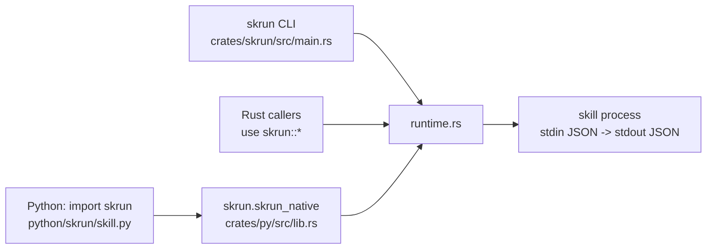

# 概览

[English](../01-overview.md) · **中文**

skrun 是一个面向 *skill* 的小型本地运行时。skill 就是一个目录，里面要么是指导性文本（`SKILL.md`），要么是遵循固定 JSON 契约的可执行程序。skrun 负责为这些目录生成脚手架、构建、安装和运行，这样你已经在用的 agent 框架（LangChain、LangGraph、PydanticAI、OpenAI Agents）就能像调用普通函数一样调用 Rust 二进制或由 uv 管理的 Python 脚本：传入一个 dict，返回一个 dict。

它刻意不做规划、对话、状态存储或凭据管理：runtime 模块明确把这些列为自己不该负责的事。agent 循环仍由你掌控；skrun 只负责把“磁盘上的一个工具”变成“一个 JSON 进，一个 JSON 对象出”。

建议先读 [快速上手](02-getting-started.md)，在 [参考](03-reference.md) 中查准确名称，再通过 [工作原理](04-how-it-works.md) 了解一次调用是如何执行的。

来源: [runtime.rs:1-37](../../crates/skrun/src/runtime.rs#L1-L37) · [README.md:11-19](../../README.md#L11-L19)

## 三种 skill

每个 skill 目录都有一个 `kind`（`ArtifactKind`）：

| kind | 是什么 | 如何运行 |
|---|---|---|
| `markdown` | 只有指导内容，通常只有 `SKILL.md` | 不运行；可以列出和查看，`build` 和 `run` 会拒绝 |
| `rust_binary` | 一个 Cargo 项目 | 运行 `entry` 处构建好的可执行文件 |
| `python_uv` | 一个 uv 项目 | `uv run --project <dir> python <entry>` |

`SkillArtifact::validate` 把 `executable` 与 kind 绑定：markdown skill 必须是 `executable: false`，另外两种必须可执行，必须指定 `entry`，并使用 `stdio-json` 传输方式。正因如此，同一种目录格式既能承载提示词类 skill，也能承载真正的程序。

来源: [runtime.rs:55-61](../../crates/skrun/src/runtime.rs#L55-L61) · [runtime.rs:206-241](../../crates/skrun/src/runtime.rs#L206-L241)

## 一个运行时，三个入口

所有行为都在一个 Rust 模块 `crates/skrun/src/runtime.rs` 中。`skrun` crate 既把它作为库重新导出，也附带 `skrun` CLI 二进制。Python 通过 `skrun-native`（`crates/py`）调用同一份代码，这是一个 PyO3 扩展，由 maturin 安装为 `skrun.skrun_native`；纯 Python 的 `skrun` 包只负责转换参数和 JSON。

由于 Python 包没有子进程后备方案，通过 Python 调用和通过 CLI 调用时，skill 的校验和执行方式完全相同。

来源: [lib.rs:1-13](../../crates/skrun/src/lib.rs#L1-L13) · [lib.rs:103-129](../../crates/py/src/lib.rs#L103-L129) · [skill.py:295-321](../../python/skrun/skill.py#L295-L321) · [pyproject.toml:38-44](../../pyproject.toml#L38-L44)

## 为什么工作区这么小

skrun 脱胎于一个更大的 agent 项目。直到 2026 年 10 月，工作区里还留着旧 agent 核心的十四个 crate（agent、chat、engine、server、store 等），以及 `crates/runtime` 和 `crates/cli` 中 runtime 与 CLI 的重复副本。它们都没有被任何已发布的接口使用，于是提交 `b6a4feb` 删除了它们，只保留 `crates/skrun` 和 `crates/py`，并让 PyO3 模块直接指向 `skrun`。更早的 `b4c1afe` 已经让 `skrun` 做到自包含，因此无需依赖工作区内部 crate 就能发布到 crates.io。最终结果是一个运行时 crate 加一个绑定 crate。

来源: [commit b6a4feb](https://github.com/lhwzds/skrun/commit/b6a4feb) · [commit b4c1afe](https://github.com/lhwzds/skrun/commit/b4c1afe)
