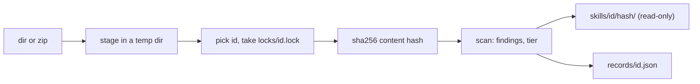

# 存储与风险等级

<sub>[English](../05-store.md) · **中文**</sub>

`skrun catalog add` 把来自别处的 skill（另一个仓库、下载的 zip）复制进本地存储，`inspect` 则显示收到了什么。两者都不会执行、构建或导入 skill 中的任何东西，也不访问网络：存储是在决定安装之前查看 skill 的地方（[工作原理](04-how-it-works.md)）。

```bash
skrun catalog add <dir|zip> [--store <dir>] [--id <id>] [--from <provenance>] [--json]
skrun catalog inspect <id> [--store <dir>] [--json]
skrun catalog inspect --list [--store <dir>] [--json]
```

`add` 打印 `stored`、`already stored` 或 `already stored (record refreshed)`，后面跟 id、版本哈希、文件数和发现项数量以及等级；`--json` 打印该版本的记录。`inspect` 打印每个版本的来源、脚本、按严重程度分组的发现项和等级理由；`--list` 为每个 id 的最新版本打印一行（`--json` 在这里同样可用，只是用法说明里没写）。查看一个从未添加过的 id 会失败。打印的每个字符串都会经过 `redact`，手工编辑过的记录也一样。

<sub>来源: [main.rs:676-771](../../crates/skrun/src/main.rs#L676-L771) · [main.rs:858-923](../../crates/skrun/src/main.rs#L858-L923) · [store.rs:594-726](../../crates/skrun/src/store.rs#L594-L726) · [store.rs:531-583](../../crates/skrun/src/store.rs#L531-L583)</sub>

## add 存储了什么



存储根目录依次取 `--store`、`$SKRUN_STORE`、`~/.skrun/store`。id 依次取 `--id`、源自身的名字（目录名或 zip 文件名去掉扩展名，取自真实路径，所以 `add .` 也可用），当源的名字不是合法 id 时再取去掉 YAML 引号的 frontmatter `name`（[参考](03-reference.md)）。优先使用源的名字，能让两位作者同 `name` 的 skill 保持分开。

内容哈希覆盖每个文件的路径和字节；用它的一段短前缀命名版本目录，该目录先在旁边建好再改名就位，所以版本绝不会以写了一半的状态出现。`records/<id>.json` 列出每个版本：哈希、`--from`、时间、文件数和字节数、frontmatter 的 name 和 description、带语言和 Python 导入的脚本、发现项、等级及理由。它在 per-id 锁之下先写入临时文件再改名。再次添加完全相同的内容不会存入新版本；只有扫描结果变化时，才会刷新该版本的脚本、发现项和等级。

<sub>来源: [store.rs:300-321](../../crates/skrun/src/store.rs#L300-L321) · [store.rs:323-487](../../crates/skrun/src/store.rs#L323-L487) · [store.rs:489-520](../../crates/skrun/src/store.rs#L489-L520) · [store.rs:746-825](../../crates/skrun/src/store.rs#L746-L825) · [store.rs:1092-1114](../../crates/skrun/src/store.rs#L1092-L1114) · +3</sub>

## add 会拒绝什么

源会先被暂存到一个全新的临时目录，被拒绝的源永远不会进入存储。`add` 在以下情况失败：

- 源本身是符号链接。目录中的符号链接从不跟随也不复制，而是各自记为一个 `symlink` 发现项；
- 源、文件或 zip 条目的名字不是 UTF-8；
- zip 条目是绝对路径或离开归档根目录的路径、是符号链接条目，归档超过 5,000 个条目、解压后超过 50 MB，或某个条目的压缩比超过 100；
- 顶层或唯一的顶层文件夹中没有 `SKILL.md`（所以仓库文件夹打成的 zip 也可用）；
- id 不符合 id 规则，或另一个 `add` 持有同一 id 的锁达 10 秒。

复制目录时会跳过 `.git`、`.venv`、`__pycache__`、`node_modules` 和 `target` 文件夹，因此它们既不存储也不参与哈希。

<sub>来源: [store.rs:59-87](../../crates/skrun/src/store.rs#L59-L87) · [store.rs:827-849](../../crates/skrun/src/store.rs#L827-L849) · [store.rs:870-955](../../crates/skrun/src/store.rs#L870-L955) · [store.rs:957-1090](../../crates/skrun/src/store.rs#L957-L1090) · [store.rs:1566-1584](../../crates/skrun/src/store.rs#L1566-L1584)</sub>

## 风险规则

`scan_skill` 把每个存储的文件按有损 UTF-8 读成文本；每条规则对每个文件报告第一处匹配，形式为 `path:line`。二进制文件和非常大的文件跳过模式规则，但不跳过密钥检查。

| 严重程度 | 规则 | 发现什么 |
|---|---|---|
| high | `remote_exec` | curl 或 wget 通过管道交给 shell 或 Python；`iex`、`Invoke-Expression`、`DownloadString` |
| high | `decode_exec` | 解码调用（`b64decode`、`fromhex`、`atob`、带 base64 的 `Buffer.from` 等）之后 160 个字符内出现 exec、eval、compile 或 sh |
| high | `reverse_shell`、`cred_theft`、`exfil_endpoint`、`persistence`、`av_evasion` | /dev/tcp 和 nc -e；SSH 密钥、AWS 凭据、钥匙串、浏览器 cookie、具名钱包；webhook 或粘贴服务以及指向公网 IPv4 主机的 URL；cron、LaunchAgents、shell rc 文件；绕过隔离属性、Gatekeeper、SIP 或 Defender |
| high | `binary` | 二进制扩展名或魔数（ELF、Mach-O、PE） |
| medium | `obfuscation` | 很长的 base64 或十六进制转义串，大量 `_0x` 标识符 |
| medium | `social_engineering` | 仅限 Markdown 和文本文件：复制/粘贴到终端，带密码的压缩包 |
| medium | `secret`、`symlink`、`shadows_stdlib` | [参考](03-reference.md) 中的密钥模式；被跳过的符号链接；以危险模块命名的 Python 文件或包（见下文） |

已知缺陷：在 JavaScript 中，`Buffer.from(...)` 参数里的注释会让 `decode_exec` 漏报。

<sub>来源: [risk.rs:377-480](../../crates/skrun/src/risk.rs#L377-L480) · [risk.rs:492-550](../../crates/skrun/src/risk.rs#L492-L550) · [risk.rs:616-685](../../crates/skrun/src/risk.rs#L616-L685) · [risk.rs:722-805](../../crates/skrun/src/risk.rs#L722-L805) · [store.rs:1134-1218](../../crates/skrun/src/store.rs#L1134-L1218) · +3</sub>

## 建议的等级

`suggest_tier` 按第一条适用的行为每个版本给出 `tier` 和 `tier_reasons`：

| 等级 | 条件 | 适合运行在 |
|---|---|---|
| `L3` | 任意 high 发现项 | microVM，绝不在其外 |
| `L2` | 非 Python 脚本（shell、JavaScript、TypeScript）、第三方导入，或危险的标准库导入（`subprocess`、`socket`、`urllib`、`http`、`threading` 等） | 容器 |
| `L1` | 文件系统导入（`os`、`pathlib`、`shutil`、`io` 等）或 `open(` 调用 | 沙箱 |
| `L0` | 只做计算的 Python 脚本 | 普通进程 |
| `none` | 没有脚本 | 无需运行 |

一个 Python 导入只要不在 CPython 3.14 的 `sys.stdlib_module_names` 中、也不是本地模块，就算第三方导入。本地模块指脚本所在文件夹或其上直到 skill 根目录的任一文件夹中的 `.py` 文件，或含有此类文件的文件夹。危险模块从不算本地模块，所以附带一个 `subprocess.py` 不能降低等级，而是记为 `shadows_stdlib` 发现项。只解析 Python 导入；其他语言按语言直接归为 `L2`。

等级只是记录下来的建议：skrun 目前没有沙箱，也没有任何地方读回这个等级。

<sub>来源: [store.rs:126-146](../../crates/skrun/src/store.rs#L126-L146) · [store.rs:1353-1429](../../crates/skrun/src/store.rs#L1353-L1429) · [store.rs:1220-1291](../../crates/skrun/src/store.rs#L1220-L1291) · [risk.rs:43-47](../../crates/skrun/src/risk.rs#L43-L47) · [risk.rs:347-376](../../crates/skrun/src/risk.rs#L347-L376) · +1</sub>
