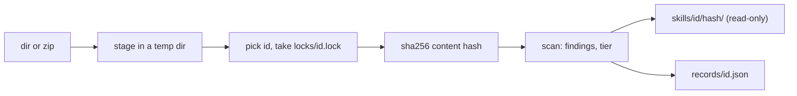

# 存储与风险等级

<sub>[English](../05-store.md) · **中文**</sub>

`skrun catalog add` 把来自别处的 skill（另一个仓库、下载的 zip）复制进本地存储；`inspect` 显示收到了什么。两者都不会执行、构建或导入 skill 中的任何东西，也不访问网络：存储是安装之前查看 skill 的地方（[工作原理](04-how-it-works.md)）。

```bash
skrun catalog add <dir|zip> [--store <dir>] [--id <id>] [--from <provenance>] [--json]
skrun catalog inspect <id> [--store <dir>] [--json]
skrun catalog inspect --list [--store <dir>] [--json]
```

`add` 打印 `stored`、`already stored` 或 `already stored (record refreshed)`，并附上 id、版本哈希、文件数和发现项数以及等级；`--json` 打印版本记录。`inspect` 打印每个版本的来源、脚本、按严重程度分组的发现项和等级理由；`--list` 为每个 id 用一行打印其最新版本。所有打印的字符串都经过 `redact`，手工编辑过的记录也不例外。

<sub>来源: [main.rs:676-771](../../crates/skrun/src/main.rs#L676-L771) · [main.rs:858-923](../../crates/skrun/src/main.rs#L858-L923) · [store.rs:646-785](../../crates/skrun/src/store.rs#L646-L785) · [store.rs:583-635](../../crates/skrun/src/store.rs#L583-L635)</sub>

## add 存储了什么



id 依次取 `--id`、源自身的名字（目录名或 zip 文件名去掉扩展名，取自真实路径，所以 `add .` 也可用），当源的名字不是合法 id 时再取去掉 YAML 引号的 frontmatter `name`（[参考](03-reference.md)）。这样两位作者同名的 skill 能保持分开。

`records/<id>.json` 列出每个版本：哈希、`--from`、时间、文件数和字节数、frontmatter 的 name 和 description、带语言和导入的脚本、发现项、等级及理由。它在 per-id 锁之下先写入临时文件再改名。完全相同的内容不会存入新版本；扫描结果变化时才刷新该版本的脚本、发现项和等级。

<sub>来源: [store.rs:363-539](../../crates/skrun/src/store.rs#L363-L539) · [store.rs:805-895](../../crates/skrun/src/store.rs#L805-L895) · [store.rs:2037-2097](../../crates/skrun/src/store.rs#L2037-L2097) · [catalog.rs:1208-1233](../../crates/skrun/src/catalog.rs#L1208-L1233)</sub>

## 版本哈希与文件权限

`content_hash` 按路径顺序，对每个文件依次向 sha256 输入：以大端 u64 表示的路径长度、路径、内容长度、内容，所以不同的文件集合不会得到相同的哈希。哈希的前 16 个十六进制字符命名版本目录；若该目录已存有不同内容，`version_name` 改用 32 个、再用全部 64 个字符，所以不同的内容绝不会被当成“已存储”。

版本先在旁边复制好再改名就位，绝不会以写了一半的状态出现。存储目录为 `0700`，存储的文件为 `0400`、其目录为 `0500`，记录为 `0600`。

<sub>来源: [store.rs:82-107](../../crates/skrun/src/store.rs#L82-L107) · [store.rs:541-572](../../crates/skrun/src/store.rs#L541-L572) · [store.rs:828-837](../../crates/skrun/src/store.rs#L828-L837) · [store.rs:1264-1328](../../crates/skrun/src/store.rs#L1264-L1328) · [store.rs:1856-1886](../../crates/skrun/src/store.rs#L1856-L1886)</sub>

## add 会拒绝什么

源会先被暂存到一个全新的临时目录；被拒绝的源永远不会进入存储。`add` 在以下情况失败：

- 源本身是符号链接。目录中的符号链接从不跟随也不复制，而是各自记为一个 `symlink` 发现项；
- 源、文件或 zip 条目的名字不是 UTF-8；
- zip 条目是绝对路径或离开归档根目录的路径、是符号链接条目，归档超过 5,000 个条目、解压后超过 50 MB，或某个条目的压缩比超过 100；这些限制按实际写出的字节计算，而不只看归档声明的大小；
- 顶层或唯一的顶层文件夹中没有 `SKILL.md`（所以仓库文件夹打成的 zip 也可用）；
- id 不合法，或另一个 `add` 持有该 id 的锁达 10 秒。

复制目录时跳过 `.git`、`.venv`、`__pycache__`、`node_modules` 和 `target`。

<sub>来源: [store.rs:73-116](../../crates/skrun/src/store.rs#L73-L116) · [store.rs:897-919](../../crates/skrun/src/store.rs#L897-L919) · [store.rs:940-1025](../../crates/skrun/src/store.rs#L940-L1025) · [store.rs:1027-1262](../../crates/skrun/src/store.rs#L1027-L1262) · [store.rs:1952-1970](../../crates/skrun/src/store.rs#L1952-L1970)</sub>

## 风险规则

`scan_skill` 把每个文件按有损 UTF-8 读取；每条规则对每个文件报告第一处匹配，形式为 `path:line`。二进制文件和超过 16 MB（`MAX_SCAN_BYTES`）的文件跳过这些规则，但不跳过密钥检查。

| 严重程度 | 规则 | 发现什么 |
|---|---|---|
| high | `remote_exec` | curl 或 wget 通过管道交给 shell 或 Python；`iex`、`Invoke-Expression`、`DownloadString` |
| high | `decode_exec` | 解码调用（`b64decode`、`fromhex`、`atob`、base64 的 `Buffer.from` 等）之后 160 个字符内出现 exec、eval、compile 或 sh |
| high | `reverse_shell`、`cred_theft`、`exfil_endpoint`、`persistence`、`av_evasion` | /dev/tcp、nc -e；SSH 密钥、AWS 凭据、钥匙串、浏览器 cookie、钱包；webhook 或粘贴服务、指向公网 IPv4 的 URL；cron、LaunchAgents、shell rc 文件；绕过隔离属性、Gatekeeper、SIP 或 Defender |
| high | `binary` | 二进制扩展名或魔数（ELF、Mach-O、PE） |
| medium | `obfuscation`、`social_engineering` | 很长的 base64 或十六进制转义串，大量 `_0x` 标识符；Markdown 和文本中诱导粘贴到终端或使用带密码压缩包的内容 |
| medium | `secret`、`symlink`、`unscanned`、`unparsed`、`shadows_stdlib` | 密钥；被跳过的符号链接；超过 16 MB 的文件；无法分词的 Python；与标准库模块同名、位于脚本所在文件夹或其上层的 `.py` 文件、无扩展名文件或 Python 文件夹 |

已知缺陷：JavaScript 中 `Buffer.from(...)` 参数里的注释会让 `decode_exec` 漏报。

<sub>来源: [risk.rs:379-482](../../crates/skrun/src/risk.rs#L379-L482) · [risk.rs:494-552](../../crates/skrun/src/risk.rs#L494-L552) · [risk.rs:37-43](../../crates/skrun/src/risk.rs#L37-L43) · [risk.rs:619-686](../../crates/skrun/src/risk.rs#L619-L686) · [risk.rs:725-808](../../crates/skrun/src/risk.rs#L725-L808) · +6</sub>

## 什么算密钥

除了 [参考](03-reference.md) 中的令牌，`line_has_secret` 还会标记一种赋值（`=` 或 `:`，带引号的键也算）：键中以完整单词出现 `password`、`passwd`、`pwd`、`secret`、`token`、`api_key`、`client_secret`、access key 或 private key（`x-api-key` 算，作为最后一段的 `POSTGRES_PASSWORD` 也算；`max_tokens` 不算），且值看起来是真的：至少六个非空白字符，并且不是 `$` 或 `%` 变量、表达式、类型注解或占位符（`<token>`、`changeme`、`YOUR_KEY` 等）。发现项只给出 `path:line`；`redact` 把这类字符串打印为 `<redacted>`。已知缺陷：以占位符单词开头、后跟真实密钥的 YAML 值会漏报。

<sub>来源: [catalog.rs:2608-2683](../../crates/skrun/src/catalog.rs#L2608-L2683) · [catalog.rs:2685-2763](../../crates/skrun/src/catalog.rs#L2685-L2763) · [catalog.rs:2786-2890](../../crates/skrun/src/catalog.rs#L2786-L2890) · [catalog.rs:2892-2928](../../crates/skrun/src/catalog.rs#L2892-L2928) · [commit ae10cbf](https://github.com/lhwzds/skrun/commit/ae10cbf)</sub>

## 如何识别脚本和导入

文件按扩展名（`.py`、`.sh`、`.js`/`.mjs`、`.ts`）认定为脚本，否则看 `#!` 行：`sh`、`bash`、`zsh`、`dash` 是 shell，`python*` 是 Python，`node`、`deno`、`bun` 是 JavaScript，其他一律为 `other`。Python 导入只在字符串和注释之外计算，同一行 `;` 或 `:` 之后的也算（`if True: import x`），另外还有以字符串字面量调用的 `__import__` 和 `importlib.import_module`。无法分词的 Python（括号不配对、字符串未结束、缩进错误）记为 `unparsed`。已知缺陷：`__import__` 中用三引号字符串写的模块名会漏报。

一个导入只要不在 CPython 3.14 的 `sys.stdlib_module_names` 中、也不是本地模块，就算第三方导入。本地模块指脚本所在文件夹或其上层中的 `.py` 文件，或含有此类文件的文件夹。

<sub>来源: [store.rs:1608-1652](../../crates/skrun/src/store.rs#L1608-L1652) · [catalog.rs:1335-1394](../../crates/skrun/src/catalog.rs#L1335-L1394) · [catalog.rs:1638-1679](../../crates/skrun/src/catalog.rs#L1638-L1679) · [catalog.rs:1769-1815](../../crates/skrun/src/catalog.rs#L1769-L1815) · [store.rs:1469-1540](../../crates/skrun/src/store.rs#L1469-L1540) · +2</sub>

## 建议的等级

`suggest_tier` 把第一条匹配的行记为 `tier`，并附上 `tier_reasons`：

| 等级 | 条件 | 适合运行在 |
|---|---|---|
| `L3` | high 发现项、`unscanned` 的脚本，或遮蔽危险模块（`subprocess`、`socket`、`threading` 等）的文件 | microVM |
| `L2` | 非 Python 脚本（shell、JavaScript、TypeScript、`other`）、第三方或危险导入、`unscanned` 或 `unparsed` 的文件、任何 `shadows_stdlib` | 容器 |
| `L1` | 文件系统导入（`os`、`pathlib`、`shutil`、`io` 等）或 `open(` 调用 | 沙箱 |
| `L0` | 只做计算的 Python 脚本 | 普通进程 |
| `none` | 没有脚本 | 无需运行 |

附带一个 `subprocess.py` 只会提高等级，绝不会降低。等级只是记录下来的建议：skrun 目前没有沙箱，也没有任何地方读回这个等级。

<sub>来源: [store.rs:155-175](../../crates/skrun/src/store.rs#L155-L175) · [store.rs:1672-1814](../../crates/skrun/src/store.rs#L1672-L1814) · [risk.rs:45-49](../../crates/skrun/src/risk.rs#L45-L49) · [risk.rs:349-378](../../crates/skrun/src/risk.rs#L349-L378) · [risk.rs:869-875](../../crates/skrun/src/risk.rs#L869-L875)</sub>
