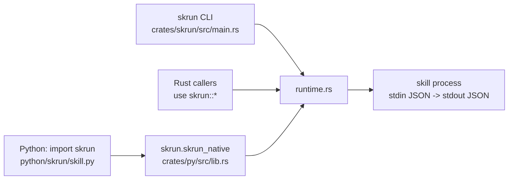
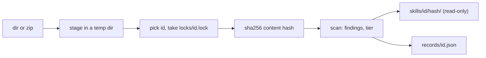

# skrun

<sub>[English](../all.md) · **中文**</sub>

这份文档面向想把本地工具打包成可执行 skill、并在 agent 框架中调用它们的开发者。内容包括：skill 制品是什么；如何通过 CLI 或 Python 生成脚手架、构建、安装和运行 skill；清单字段、命令行参数和环境变量的准确名称；Rust 运行时如何强制执行 stdio JSON 契约；以及如何参与仓库本身的开发。README 负责简要介绍，这些页面则更深入一层，内容均依据代码编写。

<a id="overview"></a>

## 概览

skrun 是一个面向 *skill* 的小型本地运行时。skill 就是一个目录，里面要么是指导性文本（`SKILL.md`），要么是遵循固定 JSON 契约的可执行程序。skrun 负责为这些目录生成脚手架、构建、安装和运行，这样你已经在用的 agent 框架（LangChain、LangGraph、PydanticAI、OpenAI Agents）就能像调用普通函数一样调用 Rust 二进制或由 uv 管理的 Python 脚本：传入一个 dict，返回一个 dict。

它刻意不做规划、对话、状态存储或凭据管理：runtime 模块明确把这些列为自己不该负责的事。agent 循环仍由你掌控；skrun 只负责把“磁盘上的一个工具”变成“一个 JSON 进，一个 JSON 对象出”。

建议先读 [快速上手](#getting-started)，在 [参考](#reference) 中查准确名称，再通过 [工作原理](#how-it-works) 了解一次调用是如何执行的。

<sub>来源: [runtime.rs:1-37](../../crates/skrun/src/runtime.rs#L1-L37) · [README.md:11-19](../../README.md#L11-L19)</sub>

### 三种 skill

每个 skill 目录都有一个 `kind`（`ArtifactKind`）：

| kind | 是什么 | 如何运行 |
|---|---|---|
| `markdown` | 只有指导内容，通常只有 `SKILL.md` | 不运行；可以列出和查看，`build` 和 `run` 会拒绝 |
| `rust_binary` | 一个 Cargo 项目 | 运行 `entry` 处构建好的可执行文件 |
| `python_uv` | 一个 uv 项目 | `uv run --project <dir> python <entry>` |

`SkillArtifact::validate` 把 `executable` 与 kind 绑定：markdown skill 必须是 `executable: false`，另外两种必须可执行，必须指定 `entry`，并使用 `stdio-json` 传输方式。正因如此，同一种目录格式既能承载提示词类 skill，也能承载真正的程序。

<sub>来源: [runtime.rs:55-61](../../crates/skrun/src/runtime.rs#L55-L61) · [runtime.rs:206-241](../../crates/skrun/src/runtime.rs#L206-L241)</sub>

### 一个运行时，三个入口

skill 的行为都在一个 Rust 模块 `crates/skrun/src/runtime.rs` 中；`catalog` 只负责指导性 skill 目录的记账工作（[参考](#reference)），`store` 与 `risk` 则把外部 skill 复制进本地存储并在不运行它们的前提下扫描（[存储与风险等级](#store)）。`skrun` crate 既把运行时作为库重新导出，也附带 `skrun` CLI 二进制。Python 通过 `skrun-native`（`crates/py`）调用同一份代码，这是一个 PyO3 扩展，由 maturin 安装为 `skrun.skrun_native`；纯 Python 的 `skrun` 包只负责转换参数和 JSON。



由于 Python 包没有子进程后备方案，通过 Python 调用和通过 CLI 调用时，skill 的校验和执行方式完全相同。

<sub>来源: [lib.rs:1-16](../../crates/skrun/src/lib.rs#L1-L16) · [lib.rs:103-129](../../crates/py/src/lib.rs#L103-L129) · [skill.py:295-321](../../python/skrun/skill.py#L295-L321) · [pyproject.toml:38-44](../../pyproject.toml#L38-L44)</sub>

### 为什么工作区这么小

skrun 脱胎于一个更大的 agent 项目。直到 2026 年 10 月，工作区里还留着旧 agent 核心的十四个 crate（agent、chat、engine、server、store 等），以及 `crates/runtime` 和 `crates/cli` 中 runtime 与 CLI 的重复副本。它们都没有被任何已发布的接口使用，于是提交 `b6a4feb` 删除了它们，只保留 `crates/skrun` 和 `crates/py`，并让 PyO3 模块直接指向 `skrun`。更早的 `b4c1afe` 已经让 `skrun` 做到自包含，因此无需依赖工作区内部 crate 就能发布到 crates.io。最终结果是一个运行时 crate 加一个绑定 crate。

<sub>来源: [commit b6a4feb](https://github.com/lhwzds/skrun/commit/b6a4feb) · [commit b4c1afe](https://github.com/lhwzds/skrun/commit/b4c1afe)</sub>

<a id="getting-started"></a>

## 快速上手

构建 `rust_binary` skill 需要 Rust 工具链，构建和运行 `python_uv` skill 需要 [uv](https://docs.astral.sh/uv/)，使用 Python 包需要 Python 3.11 或更高版本。skrun 默认直接调用 `cargo` 和 `uv` 命令，所以两者都必须在 PATH 中。

<sub>来源: [runtime.rs:313-337](../../crates/skrun/src/runtime.rs#L313-L337) · [pyproject.toml:6-8](../../pyproject.toml#L6-L8)</sub>

### 安装

```bash
pip install skrun                 # 带原生扩展的 Python SDK
cargo install skrun               # 从 crates.io 安装 `skrun` CLI
cargo install --path crates/skrun # 或者：从本地检出的代码安装 CLI
```

两个包都已发布：PyPI 上是 `skrun` 0.1.0，crates.io 上是 `skrun` 0.1.1（版本为何不同见 [参与开发](#contributing)）。PyPI 发布任务运行在 `ubuntu-22.04` 和 Python 3.13 上，所以发布的二进制 wheel 只针对该平台；在其他平台上 pip 会回退到 sdist，需要 Rust 和 maturin 来编译 `skrun-native`。如果想直接基于检出的代码开发，见 [参与开发](#contributing)。

<sub>来源: [Cargo.toml:1-15](../../crates/skrun/Cargo.toml#L1-L15) · [publish-python.yml:22](../../.github/workflows/publish-python.yml#L22) · [publish-python.yml:34-37](../../.github/workflows/publish-python.yml#L34-L37)</sub>

### 创建、构建并运行一个 skill

```bash
skrun skill new --kind rust_binary --id rust-echo /tmp/rust-echo
skrun skill build /tmp/rust-echo
skrun skill run --input '{"ok":true}' /tmp/rust-echo
# {
#   "ok": true
# }
```

`new` 会生成一个独立的 Cargo 项目（`Cargo.toml` 中带一个空的 `[workspace]`，`src/main.rs` 原样回显 stdin）、不做限制的 `schema/input.json` 和 `schema/output.json`、一个 `SKILL.md`，以及 `entry: bin/release/rust-echo` 的 `artifact.json`。`build` 运行 Cargo，并把二进制复制到这个 `entry` 路径。`run` 把输入通过管道传给二进制，并格式化输出它返回的 JSON 对象。

Python 则使用 `--kind python_uv`：脚手架是一个 `pyproject.toml` 加一个回显输入的 `skill.py`，`build` 会运行 `uv lock`/`uv sync`。

<sub>来源: [runtime.rs:623-659](../../crates/skrun/src/runtime.rs#L623-L659) · [runtime.rs:828-866](../../crates/skrun/src/runtime.rs#L828-L866) · [runtime.rs:954-992](../../crates/skrun/src/runtime.rs#L954-L992) · [main.rs:123-131](../../crates/skrun/src/main.rs#L123-L131)</sub>

### 安装 skill 并从 Python 调用

`install-local` 会把 skill 目录复制到 skill 根目录（默认是 `~/.skrun/skills`，见 [参考](#reference)）：

```bash
skrun skill install-local /tmp/rust-echo
skrun skill list
skrun skill run --id rust-echo --input '{"ok":true}'
```

```python
import skrun

skrun.skill("rust-echo").call({"ok": True})        # 按 id，从 skill 根目录查找
skrun.skill("/tmp/rust-echo").call({"ok": True})   # 或者按路径
```

如果参数对应的目录中包含 `artifact.json` 或 `SKILL.md`，`skrun.skill` 就把它当作路径，否则当作 skill 根目录下的 id。由于安装是复制，重新构建 skill 后要用 `--overwrite` 重新安装（[工作原理](#how-it-works)）。

<sub>来源: [main.rs:132-157](../../crates/skrun/src/main.rs#L132-L157) · [skill.py:236-240](../../python/skrun/skill.py#L236-L240)</sub>

### 试一个真实示例

`examples/skills` 中有 `rust-echo`、`python-echo`、`regex-finder`（基于 Rust `regex` crate）和 `cdp-browser`（通过 Chrome DevTools Protocol 控制浏览器）。后两个较大的示例展示了现有命令行工具如何通过添加 `artifact.json` 和 JSON schema 变成 skill，并且每个都附带一个 `smoke.json` 输入：

```bash
skrun skill build examples/skills/regex-finder
skrun skill run --input "$(cat examples/skills/regex-finder/smoke.json)" examples/skills/regex-finder
```

`regex-finder` 接收 `{"action": "match", "input": {"pattern": ..., "text": ...}}`（或 `"action": "describe"`），并返回一个包含 `ok`/`action`/`data`/`error` 的信封结构。构建会把 `bin/release/regex-finder` 写入示例目录中。

<sub>来源: [artifact.json](../../examples/skills/regex-finder/artifact.json) · [smoke.json](../../examples/skills/regex-finder/smoke.json) · [main.rs:91-117](../../examples/skills/regex-finder/src/main.rs#L91-L117) · [release-skills.yml:75-82](../../.github/workflows/release-skills.yml#L75-L82)</sub>

### 从 agent 框架调用 skill

skrun 没有任何框架适配器；工具函数体只需一行，工具 schema 由框架自己的装饰器或包装器提供：

```python
import skrun

def regex_finder_tool(pattern: str, text: str) -> dict:
    return skrun.skill("regex-finder").call(
        {"action": "match", "input": {"pattern": pattern, "text": text}}
    )
```

`examples/frameworks` 中为 LangChain、LangGraph、PydanticAI 和 OpenAI Agents 提供了相同结构的示例。LangChain 示例把工具的 `arguments` dict 原样传入。另外三个构造的是 `{"pattern": ..., "path": ...}`，而 `regex-finder` 要求 `text`，所以会拒绝；请使用上面的输入结构。每个 skill 中的 `schema/input.json` 天然适合作为框架参数 schema 的来源。错误以 `SkillRuntimeError` 的形式抛出，大多数框架会把它反馈给模型。

<sub>来源: [langchain_tool.py:15-18](../../examples/frameworks/langchain_tool.py#L15-L18) · [langgraph_node.py:10-19](../../examples/frameworks/langgraph_node.py#L10-L19) · [main.rs:91-117](../../examples/skills/regex-finder/src/main.rs#L91-L117) · [input.json](../../examples/skills/regex-finder/schema/input.json) · [skill.py:172-173](../../python/skrun/skill.py#L172-L173) · +2</sub>

<a id="reference"></a>

## 参考

CLI、环境变量、文件格式和 Python API 的准确名称，均摘自代码。`skrun`、`skrun -h`、`skrun --help` 和 `skrun help` 都会打印用法说明。

<sub>来源: [main.rs:337-340](../../crates/skrun/src/main.rs#L337-L340) · [main.rs:1004-1023](../../crates/skrun/src/main.rs#L1004-L1023)</sub>

### CLI 命令与参数

skill 命令都在 `skrun skill` 下；`skrun catalog` 见下文。位置参数 `<dir>` / `<id>` 可以出现在参数之间的任意位置。

| 命令 | 参数（默认值） |
|---|---|
| `new <dir>` | `--kind markdown\|guidance\|rust_binary\|python_uv`（必填）、`--id`（必填）、`--name`（id 转为首字母大写：`regex-finder` → `Regex Finder`）、`--version`（`0.1.0`） |
| `build <dir>` | `--profile`（`release`）、`--target-dir`、`--cargo`（`cargo`）、`--uv`（`uv`） |
| `run <dir>` 或 `run --id <id>` | `--input`（`{}`；必须是 JSON 对象）、`--timeout` 秒数（`60`）、`--uv`（`uv`）、`--root`（仅配合 `--id`） |
| `install-local <dir>` | `--root`、`--id`（安装时重命名）、`--overwrite` |
| `list` | `--root`、`--format text\|json`（`text`） |
| `show <id>` | `--root`、`--format text\|json`（`text`） |

`--root` 默认为 skill 根目录（见下文）。`list` 和 `show` 打印以制表符分隔的 `id kind version name`。`run` 不接受同时给出目录和 `--id`。`--cargo` 和 `--uv` 没有写进用法说明。出错时向 stderr 打印 `Error: ...` 并以 1 退出，用法错误（未知、缺失或无效的参数）则以 2 退出；看起来像密钥的回显参数和路径显示为 `<redacted>`。

<sub>来源: [main.rs:49-66](../../crates/skrun/src/main.rs#L49-L66) · [main.rs:364-395](../../crates/skrun/src/main.rs#L364-L395) · [main.rs:397-468](../../crates/skrun/src/main.rs#L397-L468) · [main.rs:470-537](../../crates/skrun/src/main.rs#L470-L537) · [main.rs:939-968](../../crates/skrun/src/main.rs#L939-L968) · +1</sub>

### Catalog 命令

`skrun catalog` 处理的是一个指导性 skill 目录：含 `SKILL.md` 的非隐藏子目录，以及除 `SKILL_REGISTRY.md`、`README.md`、`README_CN.md`、`AGENTS.md` 和 `CLAUDE.md` 之外的顶层 `*.md`。其中 `add` 和 `inspect` 处理的是存储（[存储与风险等级](#store)）。

| 命令 | 参数（默认值） | 何时以 1 退出 |
|---|---|---|
| `index <dir>` | `--out <file>`（stdout） | 目录无法读取 |
| `registry <dir>` | `--registry`（`<dir>/SKILL_REGISTRY.md`）、`--write` | 不带 `--write` 时：表格有偏差；任何模式下：文件不存在、没有表格，或无法读写 |
| `check <dir>` | `--registry`、`--index` | 有任何错误 |
| `search <dir> <query>...` | `--kind folder\|flat`、`--has-scripts`、`--limit`（`10`）、`--json` | 没有匹配（`--json` 打印 `[]`） |

`check` 报为错误的有：缺少 frontmatter `name` 或 `description` 的文件夹 skill、失效的相对链接、缺失或有偏差的注册表表格、过期的 `skills.json`，以及含密钥的行。唯一的警告是 frontmatter `name` 与目录名不同。

密钥指私钥块、以 `AKIA`、`sk-`（含 `sk-proj-`、`sk-ant-`）、`gh[pousr]_`、`github_pat_`、`glpat-`、`xox[baprs]-` 或 `AIza` 开头的令牌，以及 `password: …` 这类通用赋值（[存储与风险等级](#store)）。`check`、`registry` 和 `search` 打印的用户文本若匹配，会显示为 `<redacted>`（`redact`）；密钥发现只给出 `path:line`。`skills.json` 保留真实路径（[工作原理](#how-it-works)）。

<sub>来源: [main.rs:173-211](../../crates/skrun/src/main.rs#L173-L211) · [main.rs:783-856](../../crates/skrun/src/main.rs#L783-L856) · [main.rs:539-771](../../crates/skrun/src/main.rs#L539-L771) · [catalog.rs:66-72](../../crates/skrun/src/catalog.rs#L66-L72) · [catalog.rs:373-420](../../crates/skrun/src/catalog.rs#L373-L420) · +6</sub>

### 环境变量与默认路径

| 名称 | 作用 |
|---|---|
| `SKRUN_SKILLS_DIR` | `run --id`、`install-local`、`list`、`show` 和 Python SDK 使用的 skill 根目录 |
| `HOME` | 后备根目录 `$HOME/.skrun/skills`；两者都未设置时，CLI 和 Rust 调用方会以 `HOME is not set` 失败 |
| `SKRUN_STORE` | 未给 `--store` 时 `catalog add` 和 `inspect` 使用的存储，否则为 `$HOME/.skrun/store`（[存储与风险等级](#store)） |

CLI 会提前计算这个默认值（`root.unwrap_or(default_skills_dir()?)`），所以两个变量都未设置时，即使传了 `--root`，`run --id`、`install-local`、`list` 和 `show` 也会以 `HOME is not set` 失败。

`build` 构建 `rust_binary` 时，除非指定 `--target-dir`，否则使用 `<system temp dir>/skrun-skill-targets/<id>` 作为 Cargo 的 target 目录，因此 skill 构建不会在 skill 目录中留下 Cargo target 目录。Python SDK 自行解析同样的根目录（会展开 `~`），设置了 `root=` 参数时则直接传递该参数。

<sub>来源: [runtime.rs:50-53](../../crates/skrun/src/runtime.rs#L50-L53) · [runtime.rs:719-725](../../crates/skrun/src/runtime.rs#L719-L725) · [runtime.rs:954-959](../../crates/skrun/src/runtime.rs#L954-L959) · [skill.py:242-248](../../python/skrun/skill.py#L242-L248) · [main.rs:455-463](../../crates/skrun/src/main.rs#L455-L463) · +4</sub>

### artifact.json

`artifact.json` 会反序列化为 `SkillArtifact`，未知的键会被忽略。

| 字段 | 是否必填 | 说明 |
|---|---|---|
| `schema_version` | 是 | 必须为 `1` |
| `kind` | 是 | `markdown`、`rust_binary`、`python_uv` |
| `id`, `name`, `version` | 是 | 字符串；`id` 会被校验（见下文） |
| `executable` | 否，默认 `true` | `markdown` 必须为 `false` |
| `entry` | 可执行类型必填 | 指向二进制或 Python 脚本的相对路径 |
| `protocol` | 否 | `transport`、`input`、`output`；默认分别为 `stdio-json`、`single-json-value`、`single-json-value`。只检查 `transport`。 |
| `schema` | 否 | `input`、`output`：指向 JSON Schema 文件的相对路径 |
| `description`, `tags`, `suggested_tools`, `content`, `source_ref` | 否 | 元数据；缺省时从 `SKILL.md` 填充 |
| `source` | 否 | `{"type": ..., "ref": ...}` 来源信息，例如 `"type": "git"` |

schema 文件是写给调用方看的文档：对可执行类型，运行时会检查它们的路径是否为相对路径，但从不按 schema 校验输入或输出。

<sub>来源: [runtime.rs:63-123](../../crates/skrun/src/runtime.rs#L63-L123) · [runtime.rs:252-254](../../crates/skrun/src/runtime.rs#L252-L254) · [runtime.rs:214-238](../../crates/skrun/src/runtime.rs#L214-L238)</sub>

### SKILL.md frontmatter

`SKILL.md` 可以以一个 `---` 块开头。skrun 只读取下列键，用的是一个极简的逐行解析器，而不是完整的 YAML 解析：

- `name`、`description`、`version`
- `source_ref`（别名 `ref`）
- `tags`、`suggested_tools`：行内写法 `[a, b]` / `a, b`，或在后续行使用 `- item` 列表

值两侧的引号会被去掉；其他所有键（包括示例中的 `id:` 和 `kind:`）都会被忽略。块之后的文本成为 `content`。对于只有 `SKILL.md` 的目录，id 就是目录名，name 依次回退到第一个 `# ` 标题和首字母大写的 id，version 默认为 `0.1.0`。

<sub>来源: [runtime.rs:458-563](../../crates/skrun/src/runtime.rs#L458-L563) · [runtime.rs:392-425](../../crates/skrun/src/runtime.rs#L392-L425)</sub>

### id 与路径规则

id 不能为空，只能包含 ASCII 字母、数字、`-` 和 `_`，并且必须以字母或数字开头。`install-local` 的 `--id` 也做同样的检查，所以安装后的目录名始终是一个安全的单级路径段。

对于可执行类型（`rust_binary`、`python_uv`），`entry`、`schema.input` 和 `schema.output` 必须是非空的相对路径，且不能包含 `..` 或根路径成分：这只是对路径文本的检查，目录内的符号链接仍可能解析到目录之外。`markdown` 制品的 `schema.*` 路径不做检查。

<sub>来源: [runtime.rs:789-826](../../crates/skrun/src/runtime.rs#L789-L826) · [runtime.rs:206-241](../../crates/skrun/src/runtime.rs#L206-L241)</sub>

### Python API

| 调用 | 返回值 |
|---|---|
| `skrun.skill(id_or_path, root=None)` | `SkillHandle`（加载并校验制品） |
| `SkillHandle.call(value=None, timeout=60.0)` | skill 输出的 `dict` |
| `skrun.list_skills(root=None)` | `list[SkillArtifact]` |
| `skrun.install_local_skill(source, root=None, *, skill_id=None, overwrite=False)` | 按已安装清单中的 id 查找到的 `SkillHandle` |
| `skrun.build_skill(root, target_dir=None)` | `SkillArtifact` |
| `skrun.load_artifact(root)` | `SkillArtifact` |

`SkillRuntime(root=..., uv=...)` 把同样的操作组织在同一个 skill 根目录下。所有失败（包括缺少原生扩展）都会抛出 `SkillRuntimeError`。有两处与 CLI 不同：`timeout` 会被截断为整秒；`SkillRuntime`/`SkillHandle` 上的 `uv` 字段只是存着，并不会传给原生调用，所以 Python skill 总是运行 PATH 中找到的 `uv`。

已知问题：`install_local` 返回 `self.skill(artifact.id)`。当用 `skill_id=` 重命名一个带 `artifact.json` 的 skill 时，副本保留清单中的 id，因此 handle 解析到 `<root>/<original id>`，而不是副本。请用 `skrun.skill(skill_id, root=...)` 查找它。

<sub>来源: [__init__.py:7-35](../../python/skrun/__init__.py#L7-L35) · [skill.py:172-234](../../python/skrun/skill.py#L172-L234) · [skill.py:251-292](../../python/skrun/skill.py#L251-L292)</sub>

<a id="how-it-works"></a>

## 工作原理

每个操作的起点都一样：`load_artifact` 把 skill 目录读取为一个经过校验的 `SkillArtifact`。之后 `build_skill` 和 `run_skill` 按它的 `kind` 分发处理；`install_local_skill` 则复制目录，跳过 `.venv` 和构建缓存。没有守护进程、缓存或注册中心，文件系统就是唯一的状态。

<sub>来源: [runtime.rs:594-609](../../crates/skrun/src/runtime.rs#L594-L609)</sub>

### 加载 skill 目录

如果存在 `artifact.json`，先解码它，再由 `apply_skill_markdown` 用 `SKILL.md` 填充清单中留空的元数据字段（`description`、`tags`、`suggested_tools`、`content`、`source_ref`）。清单始终优先。如果没有 `artifact.json`，目录中必须有 `SKILL.md`，并成为一个以目录名命名的 `markdown` skill。无论哪种情况，`validate` 都在最后运行，所以每个调用方（CLI、Rust 库、Python）遇到错误清单时看到的错误都一样。

<sub>来源: [runtime.rs:594-609](../../crates/skrun/src/runtime.rs#L594-L609) · [runtime.rs:427-447](../../crates/skrun/src/runtime.rs#L427-L447) · [runtime.rs:392-425](../../crates/skrun/src/runtime.rs#L392-L425)</sub>

### 一次调用如何执行

```mermaid
sequenceDiagram
  participant C as caller
  participant R as run_skill
  participant P as skill process
  C->>R: dir, JSON value, RunOptions
  R->>R: canonicalize dir, load_artifact
  R->>P: spawn in dir (rust: entry binary / python: uv run --project dir python entry)
  R->>P: stdin = JSON + "\n", then close
  loop every 10 ms until exit or timeout
    R->>P: try_wait
  end
  P-->>R: exit status, stdout, stderr
  R->>R: non-zero exit -> error; stdout must parse as a JSON object
  R-->>C: SkillRunOutput { value, stderr, exit_code }
```

工作目录就是 skill 目录，所以 skill 可以用相对路径打开自己的文件。写入一个值后就关闭 stdin，skill 因此只需一直读到 EOF。stderr 会被捕获并作为诊断信息返回，从不解析。

<sub>来源: [runtime.rs:675-717](../../crates/skrun/src/runtime.rs#L675-L717) · [runtime.rs:1006-1069](../../crates/skrun/src/runtime.rs#L1006-L1069)</sub>

### 哪些情况算失败

- **超时**：超过 `timeout`（默认 60 秒）后进程会被杀掉，调用以 `skill process timed out after Ns` 失败。
- **非零退出**：调用失败，并带上退出码和去掉首尾空白的 stderr。stdout 会被丢弃，所以如果 skill 打印结构化错误内容后以 1 退出（`regex-finder` 就是这样），这些内容会丢失；请同时把消息写到 stderr，或者以 0 退出并返回 `"ok": false`。
- **输出不合法**：stdout 必须恰好是一个 JSON 值，而且必须是对象；数组、标量或多个 JSON 值都会报错（一个对象分成多行写是可以的）。

stdout 和 stderr 只在进程退出后才收集。以下未经测试，仅根据代码推断：skill 如果在退出前写入的数据超过操作系统管道缓冲区，会一直阻塞到超时；请把大结果写到文件里再返回文件路径。

<sub>来源: [runtime.rs:1027-1069](../../crates/skrun/src/runtime.rs#L1027-L1069) · [main.rs:27-35](../../examples/skills/regex-finder/src/main.rs#L27-L35)</sub>

### 构建

`rust_binary`：运行 `cargo build --manifest-path <dir>/Cargo.toml --target-dir <target>`，profile 为 `release` 时加 `--release`，否则加 `--profile <name>`，然后把 `<target>/<dir>/<id>`（加上平台的可执行文件后缀）复制到 `entry`。其中 `<dir>` 是 Cargo 的输出目录：`dev` 和 `test` 为 `debug`，`release` 和 `bench` 为 `release`，其他情况为 profile 名。因此二进制名必须与 skill id 相同。无论 profile 是什么都会复制到 `entry`，所以使用脚手架生成的 entry 时，debug 构建的产物也会落在 `bin/release/...`。

`python_uv`：仅在缺少 `uv.lock` 时运行 `uv lock --project <dir>`，然后运行 `uv sync --project <dir> --locked`。锁文件是 skill 的一部分，因此安装可复现。

两种构建步骤都会捕获输出，失败时只报告 stderr。`markdown` skill 无法构建。

<sub>来源: [runtime.rs:661-673](../../crates/skrun/src/runtime.rs#L661-L673) · [runtime.rs:946-992](../../crates/skrun/src/runtime.rs#L946-L992) · [runtime.rs:1071-1083](../../crates/skrun/src/runtime.rs#L1071-L1083)</sub>

### 安装与列出

`install_local_skill` 先校验源目录，再把它递归复制到 `<root>/<id>`。目标已存在时会以 `installed skill already exists` 失败，除非设置了 `overwrite`；设置 `overwrite` 时会先删除目标，而把目录安装到它自身时会直接返回，不做复制。复制完成后会重新加载并返回副本；只校验元数据，所以没构建过的 Rust skill 也能装上，要到运行时才失败。构建好的二进制会被复制，但任意层级下名为 `.venv`、`__pycache__`、`target` 或 `.git` 的目录都会跳过，除非 artifact 的 `entry` 就在其中。用 `--id` 重命名只改变目录名；复制过去的 `artifact.json` 仍保留原来的 `id`。

`list_installed_skills` 扫描根目录下直接包含 `artifact.json` 或 `SKILL.md` 的子目录，跳过加载失败的目录，并按 id 排序。根目录不存在时返回空列表。

<sub>来源: [runtime.rs:727-787](../../crates/skrun/src/runtime.rs#L727-L787) · [runtime.rs:1096-1113](../../crates/skrun/src/runtime.rs#L1096-L1113) · [runtime.rs:760-766](../../crates/skrun/src/runtime.rs#L760-L766)</sub>

### Python 边界

`skrun-native` 暴露五个函数（`runtime_load_artifact_json`、`runtime_list_skills_json`、`runtime_build_skill_json`、`runtime_run_skill_json`、`runtime_install_local_skill_json`）。每个函数都接收字符串并返回 JSON 字符串，Python 的 dataclass 与之一一对应。每次调用都在 `py.detach` 中运行，构建或 skill 进程运行期间会释放 GIL。Rust 错误会变成 `RuntimeError`，SDK 再把它们重新包装为 `SkillRuntimeError`。对 list 和 install，`root` 为空或缺失时回退到 `default_skills_dir`；load、build 和 run 必须显式传入 `root`。从 Python 发起的构建总是使用默认的 Cargo/uv 命令和 release profile，只有 `target_dir` 可配置。

<sub>来源: [lib.rs:39-151](../../crates/py/src/lib.rs#L39-L151) · [skill.py:316-331](../../python/skrun/skill.py#L316-L331)</sub>

### 为什么 catalog 的输出是确定的

`catalog` 从不运行 skill，也不调用 git 或网络；只有 `registry --write` 和 `index --out` 会写文件。`build_index` 按 id 排序 skill、按路径排序脚本，不含时间戳或绝对路径。每个 skill 记录：frontmatter、入口文件 `bytes`、脚本（`.py`、`.sh`、`.js`/`.mjs`、`.ts`；Python 附带导入）以及相对链接（与注册表单元格同样解析）和各目标是否存在。输入相同，`skills.json` 就相同，所以 `check` 能发现过期的副本。这里不做任何遮蔽：提交前请先检查。

`reconcile_registry` 只改动人工维护的 `SKILL_REGISTRY.md` 中围栏代码块之外的 `| Skill | When to read | Entrypoint |` 表格（反引号或 `~~~` 围栏，只在开启它的容器内关闭：顶层、列表项或引用块；信息串含反引号的行是行内代码）。有效的行原样按序保留；入口缺失、不是 skill 或重复的行被删除；未登记的 skill 追加 `| name | summary | [id](entrypoint) |`（描述的第一句，≤160 个字符）。单元格支持 `\|` 和 `\\`；含括号、空格、`<` 或 `>` 的路径写成 `[id](<path>)`。分隔行、其他行和换行符保持不变；没有表格时报错且不写入。已知缺陷：有序列表中以 4 个以上空格缩进关闭的围栏不会关闭（`registry` 随后找不到表格），列表/引用嵌套顺序颠倒可能提前关闭围栏，含 `>` 的路径无法往返。

<sub>来源: [catalog.rs:14-18](../../crates/skrun/src/catalog.rs#L14-L18) · [catalog.rs:423-455](../../crates/skrun/src/catalog.rs#L423-L455) · [catalog.rs:484-588](../../crates/skrun/src/catalog.rs#L484-L588) · [catalog.rs:3592-3635](../../crates/skrun/src/catalog.rs#L3592-L3635) · [catalog.rs:1335-1379](../../crates/skrun/src/catalog.rs#L1335-L1379) · +6</sub>

### 搜索如何排序

`search_skills` 把查询按空白拆成词并转为小写，再按子串匹配，所以中文无需分词。每个词都必须命中某个字段（AND），并累加它命中的每个字段的权重：id 5，frontmatter name 4，注册表标题 4，注册表摘要、description 和每个 tag 3，入口正文 1。结果按分数排序，同分按 id；`--has-scripts` 会去掉所有 flat skill。结果显示注册表标题（否则为 name）和注册表摘要（否则为 description 的第一句：截至 `. `、`? `、`! `、`。`、`？`、`！` 或换行，最多 120 个字符），截断前先做遮蔽，因此密钥绝不会被部分打印。

<sub>来源: [catalog.rs:717-741](../../crates/skrun/src/catalog.rs#L717-L741) · [catalog.rs:788-864](../../crates/skrun/src/catalog.rs#L788-L864) · [catalog.rs:904-958](../../crates/skrun/src/catalog.rs#L904-L958) · [catalog.rs:1016-1054](../../crates/skrun/src/catalog.rs#L1016-L1054) · [catalog.rs:78-90](../../crates/skrun/src/catalog.rs#L78-L90)</sub>

<a id="store"></a>

## 存储与风险等级

`skrun catalog add` 把来自别处的 skill（另一个仓库、下载的 zip）复制进本地存储；`inspect` 显示收到了什么。两者都不会执行、构建或导入 skill 中的任何东西，也不访问网络：存储是安装之前查看 skill 的地方（[工作原理](#how-it-works)）。

```bash
skrun catalog add <dir|zip> [--store <dir>] [--id <id>] [--from <provenance>] [--json]
skrun catalog inspect <id> [--store <dir>] [--json]
skrun catalog inspect --list [--store <dir>] [--json]
```

`add` 打印 `stored`、`already stored` 或 `already stored (record refreshed)`，并附上 id、版本哈希、文件数和发现项数以及等级；`--json` 打印版本记录。`inspect` 打印每个版本的来源、脚本、按严重程度分组的发现项和等级理由；`--list` 为每个 id 用一行打印其最新版本。所有打印的字符串都经过 `redact`，手工编辑过的记录也不例外。

<sub>来源: [main.rs:676-771](../../crates/skrun/src/main.rs#L676-L771) · [main.rs:858-923](../../crates/skrun/src/main.rs#L858-L923) · [store.rs:646-785](../../crates/skrun/src/store.rs#L646-L785) · [store.rs:583-635](../../crates/skrun/src/store.rs#L583-L635)</sub>

### add 存储了什么



id 依次取 `--id`、源自身的名字（目录名或 zip 文件名去掉扩展名，取自真实路径，所以 `add .` 也可用），当源的名字不是合法 id 时再取去掉 YAML 引号的 frontmatter `name`（[参考](#reference)）。这样两位作者同名的 skill 能保持分开。

`records/<id>.json` 列出每个版本：哈希、`--from`、时间、文件数和字节数、frontmatter 的 name 和 description、带语言和导入的脚本、发现项、等级及理由。它在 per-id 锁之下先写入临时文件再改名。完全相同的内容不会存入新版本；扫描结果变化时才刷新该版本的脚本、发现项和等级。

<sub>来源: [store.rs:363-539](../../crates/skrun/src/store.rs#L363-L539) · [store.rs:805-895](../../crates/skrun/src/store.rs#L805-L895) · [store.rs:2037-2097](../../crates/skrun/src/store.rs#L2037-L2097) · [catalog.rs:1208-1233](../../crates/skrun/src/catalog.rs#L1208-L1233)</sub>

### 版本哈希与文件权限

`content_hash` 按路径顺序，对每个文件依次向 sha256 输入：以大端 u64 表示的路径长度、路径、内容长度、内容，所以不同的文件集合不会得到相同的哈希。哈希的前 16 个十六进制字符命名版本目录；若该目录已存有不同内容，`version_name` 改用 32 个、再用全部 64 个字符，所以不同的内容绝不会被当成“已存储”。

版本先在旁边复制好再改名就位，绝不会以写了一半的状态出现。存储目录为 `0700`，存储的文件为 `0400`、其目录为 `0500`，记录为 `0600`。

<sub>来源: [store.rs:82-107](../../crates/skrun/src/store.rs#L82-L107) · [store.rs:541-572](../../crates/skrun/src/store.rs#L541-L572) · [store.rs:828-837](../../crates/skrun/src/store.rs#L828-L837) · [store.rs:1264-1328](../../crates/skrun/src/store.rs#L1264-L1328) · [store.rs:1856-1886](../../crates/skrun/src/store.rs#L1856-L1886)</sub>

### add 会拒绝什么

源会先被暂存到一个全新的临时目录；被拒绝的源永远不会进入存储。`add` 在以下情况失败：

- 源本身是符号链接。目录中的符号链接从不跟随也不复制，而是各自记为一个 `symlink` 发现项；
- 源、文件或 zip 条目的名字不是 UTF-8；
- zip 条目是绝对路径或离开归档根目录的路径、是符号链接条目，归档超过 5,000 个条目、解压后超过 50 MB，或某个条目的压缩比超过 100；这些限制按实际写出的字节计算，而不只看归档声明的大小；
- 顶层或唯一的顶层文件夹中没有 `SKILL.md`（所以仓库文件夹打成的 zip 也可用）；
- id 不合法，或另一个 `add` 持有该 id 的锁达 10 秒。

复制目录时跳过 `.git`、`.venv`、`__pycache__`、`node_modules` 和 `target`。

<sub>来源: [store.rs:73-116](../../crates/skrun/src/store.rs#L73-L116) · [store.rs:897-919](../../crates/skrun/src/store.rs#L897-L919) · [store.rs:940-1025](../../crates/skrun/src/store.rs#L940-L1025) · [store.rs:1027-1262](../../crates/skrun/src/store.rs#L1027-L1262) · [store.rs:1952-1970](../../crates/skrun/src/store.rs#L1952-L1970)</sub>

### 风险规则

`scan_skill` 把每个文件按有损 UTF-8 读取；每条规则对每个文件报告第一处匹配，形式为 `path:line`。二进制文件和超过 16 MB（`MAX_SCAN_BYTES`）的文件跳过这些规则，但不跳过密钥检查。

| 严重程度 | 规则 | 发现什么 |
|---|---|---|
| high | `remote_exec` | curl 或 wget 通过管道交给 shell 或 Python；`iex`、`Invoke-Expression`、`DownloadString` |
| high | `decode_exec` | 解码调用（`b64decode`、`fromhex`、`atob`、base64 的 `Buffer.from` 等）之后 160 个字符内出现 exec、eval、compile 或 sh |
| high | `reverse_shell`、`cred_theft`、`exfil_endpoint`、`persistence`、`av_evasion` | /dev/tcp、nc -e；SSH 密钥、AWS 凭据、钥匙串、浏览器 cookie、钱包；webhook 或粘贴服务、指向公网 IPv4 的 URL；cron、LaunchAgents、shell rc 文件；绕过隔离属性、Gatekeeper、SIP 或 Defender |
| high | `binary` | 二进制扩展名或魔数（ELF、Mach-O、PE） |
| medium | `obfuscation`、`social_engineering` | 很长的 base64 或十六进制转义串，大量 `_0x` 标识符；Markdown 和文本中诱导粘贴到终端或使用带密码压缩包的内容 |
| medium | `secret`、`symlink`、`unscanned`、`unparsed`、`shadows_stdlib` | 密钥；被跳过的符号链接；超过 16 MB 的文件；无法分词的 Python；与标准库模块同名、位于脚本所在文件夹或其上层的 `.py` 文件、无扩展名文件或 Python 文件夹 |

已知缺陷：JavaScript 中 `Buffer.from(...)` 参数里的注释会让 `decode_exec` 漏报。

<sub>来源: [risk.rs:379-482](../../crates/skrun/src/risk.rs#L379-L482) · [risk.rs:494-552](../../crates/skrun/src/risk.rs#L494-L552) · [risk.rs:37-43](../../crates/skrun/src/risk.rs#L37-L43) · [risk.rs:619-686](../../crates/skrun/src/risk.rs#L619-L686) · [risk.rs:725-808](../../crates/skrun/src/risk.rs#L725-L808) · +6</sub>

### 什么算密钥

除了 [参考](#reference) 中的令牌，`line_has_secret` 还会标记一种赋值（`=` 或 `:`，带引号的键也算）：键中以完整单词出现 `password`、`passwd`、`pwd`、`secret`、`token`、`api_key`、`client_secret`、access key 或 private key（`x-api-key` 算，作为最后一段的 `POSTGRES_PASSWORD` 也算；`max_tokens` 不算），且值看起来是真的：至少六个非空白字符，并且不是 `$` 或 `%` 变量、表达式、类型注解或占位符（`<token>`、`changeme`、`YOUR_KEY` 等）。发现项只给出 `path:line`；`redact` 把这类字符串打印为 `<redacted>`。已知缺陷：以占位符单词开头、后跟真实密钥的 YAML 值会漏报。

<sub>来源: [catalog.rs:2608-2683](../../crates/skrun/src/catalog.rs#L2608-L2683) · [catalog.rs:2685-2763](../../crates/skrun/src/catalog.rs#L2685-L2763) · [catalog.rs:2786-2890](../../crates/skrun/src/catalog.rs#L2786-L2890) · [catalog.rs:2892-2928](../../crates/skrun/src/catalog.rs#L2892-L2928) · [commit ae10cbf](https://github.com/lhwzds/skrun/commit/ae10cbf)</sub>

### 如何识别脚本和导入

文件按扩展名（`.py`、`.sh`、`.js`/`.mjs`、`.ts`）认定为脚本，否则看 `#!` 行：`sh`、`bash`、`zsh`、`dash` 是 shell，`python*` 是 Python，`node`、`deno`、`bun` 是 JavaScript，其他一律为 `other`。Python 导入只在字符串和注释之外计算，同一行 `;` 或 `:` 之后的也算（`if True: import x`），另外还有以字符串字面量调用的 `__import__` 和 `importlib.import_module`。无法分词的 Python（括号不配对、字符串未结束、缩进错误）记为 `unparsed`。已知缺陷：`__import__` 中用三引号字符串写的模块名会漏报。

一个导入只要不在 CPython 3.14 的 `sys.stdlib_module_names` 中、也不是本地模块，就算第三方导入。本地模块指脚本所在文件夹或其上层中的 `.py` 文件，或含有此类文件的文件夹。

<sub>来源: [store.rs:1608-1652](../../crates/skrun/src/store.rs#L1608-L1652) · [catalog.rs:1335-1394](../../crates/skrun/src/catalog.rs#L1335-L1394) · [catalog.rs:1638-1679](../../crates/skrun/src/catalog.rs#L1638-L1679) · [catalog.rs:1769-1815](../../crates/skrun/src/catalog.rs#L1769-L1815) · [store.rs:1469-1540](../../crates/skrun/src/store.rs#L1469-L1540) · +2</sub>

### 建议的等级

`suggest_tier` 把第一条匹配的行记为 `tier`，并附上 `tier_reasons`：

| 等级 | 条件 | 适合运行在 |
|---|---|---|
| `L3` | high 发现项、`unscanned` 的脚本，或遮蔽危险模块（`subprocess`、`socket`、`threading` 等）的文件 | microVM |
| `L2` | 非 Python 脚本（shell、JavaScript、TypeScript、`other`）、第三方或危险导入、`unscanned` 或 `unparsed` 的文件、任何 `shadows_stdlib` | 容器 |
| `L1` | 文件系统导入（`os`、`pathlib`、`shutil`、`io` 等）或 `open(` 调用 | 沙箱 |
| `L0` | 只做计算的 Python 脚本 | 普通进程 |
| `none` | 没有脚本 | 无需运行 |

附带一个 `subprocess.py` 只会提高等级，绝不会降低。等级只是记录下来的建议：skrun 目前没有沙箱，也没有任何地方读回这个等级。

<sub>来源: [store.rs:155-175](../../crates/skrun/src/store.rs#L155-L175) · [store.rs:1672-1814](../../crates/skrun/src/store.rs#L1672-L1814) · [risk.rs:45-49](../../crates/skrun/src/risk.rs#L45-L49) · [risk.rs:349-378](../../crates/skrun/src/risk.rs#L349-L378) · [risk.rs:869-875](../../crates/skrun/src/risk.rs#L869-L875)</sub>

<a id="contributing"></a>

## 参与开发

Cargo 工作区有两个成员：`crates/skrun`（默认成员：运行时库和 CLI）和 `crates/py`（`skrun-native`）。PyO3 放在可选的 `python-module` feature 之后，所以在根目录执行 `cargo build` 和 `cargo test` 从不需要 Python 解释器；只有 maturin 和原生检查会启用它。模块划分见 [代码结构](#structure)。

<sub>来源: [Cargo.toml:1-17](../../Cargo.toml#L1-L17) · [Cargo.toml:13-15](../../crates/py/Cargo.toml#L13-L15) · [build.rs](../../crates/py/build.rs)</sub>

### 本地开发流程

```bash
make test     # cargo test + python/tests 的 python unittest
make lint     # cargo fmt --check + clippy -D warnings
make python   # scripts/check.sh ci：完整打包流程
make check    # lint + test + python
```

`scripts/check.sh ci` 会创建 venv、安装 maturin、运行 Python 契约测试、用 `--features python-module` 测试并 lint `skrun-native`，然后通过 `python/scripts/package.py` 依次执行 `develop`、`smoke`、`build` 和 `sdist`。每一步也都是一个子命令（`bootstrap`、`python`、`rust`、`develop`、`smoke`、`build`、`sdist`）。它读取 `PYTHON_BIN`（`python3`）、`PYTHON_VENV`（`/tmp/skrun-python-venv`）、`CARGO_TARGET_DIR`（`/tmp/skrun-python-target`）和 `WHEEL_DIR`（`/tmp/skrun-python-dist`）。`package.py` 会自行设置 `PYO3_PYTHON` 和 `CARGO_TARGET_DIR`；默认 target 放在 `/tmp`，这样原生产物不会在外接 macOS 卷上构建或执行。`make clean` 会删除这三个 `/tmp` 路径。

<sub>来源: [Makefile](../../Makefile) · [check.sh:7-13](../../scripts/check.sh#L7-L13) · [check.sh:59-89](../../scripts/check.sh#L59-L89) · [package.py:13-41](../../python/scripts/package.py#L13-L41)</sub>

### 冒烟测试验证了什么

`package.py smoke` 在 `/tmp` 下运行，因此导入的是已安装的包而不是源码树。它会写一个临时的 `rust_binary` skill，其 entry 是一个运行 `cat` 的 `#!/bin/sh` 脚本，然后断言 `skrun.skill(root).call({'native': True})` 返回相同的 dict。用 shell 脚本就够了，因为 `rust_binary` 只要求 `entry` 处有一个可执行文件；这也让它成为在测试中包装任意现有可执行文件的快捷方法。

<sub>来源: [package.py:64-88](../../python/scripts/package.py#L64-L88)</sub>

### CI 与发布

| workflow | 触发条件 | 做什么 |
|---|---|---|
| `python.yml` | 改动代码的、针对 `main` 的 push / PR | 执行 `check.sh` 的各步骤，上传 wheel |
| `publish-crates.yml` | 标签 `v*` 或手动触发 | `cargo test -p skrun`、dry-run、`cargo publish -p skrun` |
| `publish-python.yml` | 标签 `v*` 或手动触发 | `scripts/check.sh ci`，然后发布到 PyPI（`skip-existing`） |
| `release-skills.yml` | 标签 `<skill>@<version>` 或手动触发 | 构建、冒烟运行，并把 `<skill>@<version>-x86_64-linux.tar.gz`（`artifact.json`、`SKILL.md`、`schema`、`bin`）附加到 GitHub release |

`release-skills.yml` 只接受 `regex-finder` 和 `cdp-browser`，并用 CLI 本身来构建每个示例并运行它的 `smoke.json`。crates.io 和 PyPI 的发布都使用可信发布（`id-token: write`），而不是存储的 token。各处版本号分开设置：工作区 `Cargo.toml` 写的是 0.1.1（已发布的 crate），而 `pyproject.toml` 和 `python/skrun/__init__.py` 写的是 0.1.0（已发布的 PyPI 包）。发布时三处都要更新；由于 `skip-existing`，没有更新版本号的 Python 包会被静默跳过，不会重新上传。

<sub>来源: [python.yml:1-20](../../.github/workflows/python.yml#L1-L20) · [publish-crates.yml:1-52](../../.github/workflows/publish-crates.yml#L1-L52) · [publish-python.yml:1-11](../../.github/workflows/publish-python.yml#L1-L11) · [publish-python.yml:50-57](../../.github/workflows/publish-python.yml#L50-L57) · [release-skills.yml:1-103](../../.github/workflows/release-skills.yml#L1-L103) · +3</sub>

### 新增 skill kind 或命令

新增一种 kind 需要改动 `runtime.rs` 中所有对 `ArtifactKind` 的 `match`：`validate`、`scaffold_skill`、`build_skill`、`run_skill` 和 `kind_label`，以及 `main.rs` 中的 `parse_kind` 和重复的 `kind_label`。Python 端把 `kind` 当作普通字符串，除非新 kind 需要新选项，否则无需改动。保持运行时契约不变：任何可执行的东西仍然必须从 stdin 接收一个 JSON 值，并向 stdout 返回一个 JSON 对象。

runtime、CLI、绑定和 SDK 模块开头都有一段文档头（`Owns`、`Must Not`、`Inputs`、`Outputs`、`Depends On`、`Verify`）。转移职责时要更新它，并遵守 `Must Not` 列表：runtime 不做规划、不解析 `@skill` 提及、不渲染 UI，也不保存持久状态。新操作应先放进 `runtime.rs`，再通过 `main.rs` 和 `crates/py/src/lib.rs` 暴露出去，绝不在 Python 中实现。

<sub>来源: [runtime.rs:55-61](../../crates/skrun/src/runtime.rs#L55-L61) · [runtime.rs:586-592](../../crates/skrun/src/runtime.rs#L586-L592) · [main.rs:939-968](../../crates/skrun/src/main.rs#L939-L968) · [runtime.rs:3-17](../../crates/skrun/src/runtime.rs#L3-L17)</sub>

<a id="structure"></a>

## 代码结构

本页由 Codocia 根据代码自动生成，每次 build 重新计算：功能区划分、各区自带的说明、区之间的 import 依赖，以及讲解各区的页面。

范围内共 53 个文件，16,537 行；已排除 `docs/**`、`python/tests/**`、`**/tests/**`、`Cargo.lock`、`.github/dependabot.yml`、`examples/skills/cdp-browser/src/**`、`.gitattributes`、`.gitignore`、`LICENSE`

### 文件结构

**仓库根目录**

- （根目录文件） — 466 行，5 个文件。skrun executable skill runtime internals.\
  讲解：[概览](#overview) (2), [快速上手](#getting-started) (1), [参与开发](#contributing) (3)
- `.github/` — 313 行，4 个文件\
  讲解：[快速上手](#getting-started) (2), [参与开发](#contributing) (1)
- `python/` — 548 行，4 个文件。`skrun` is the Python SDK for the skrun executable skill runtime.\
  核心文件：`skrun/skill.py` `scripts/package.py` `skrun/__init__.py`\
  讲解：[概览](#overview) (1), [快速上手](#getting-started) (2), [参考](#reference) (2), [工作原理](#how-it-works) (1), [参与开发](#contributing) (3)
- `scripts/` — 124 行，1 个文件\
  核心文件：`check.sh`\
  讲解：[参与开发](#contributing) (1)

**`crates/`**

- `py/` — 269 行，3 个文件。PyO3 module boundary for the skrun executable skill runtime.\
  核心文件：`src/lib.rs` `build.rs`\
  讲解：[概览](#overview) (1), [工作原理](#how-it-works) (1), [参与开发](#contributing) (1)

**`crates/skrun/`**

- （直接文件） — 23 行，1 个文件。Public API for the skrun executable skill runtime.\
  讲解：[快速上手](#getting-started) (1)
- `src/` — 14,113 行，6 个文件。Public API for the skrun executable skill runtime.\
  核心文件：`catalog.rs` `store.rs` `runtime.rs`\
  讲解：[概览](#overview) (3), [快速上手](#getting-started) (3), [参考](#reference) (7), [工作原理](#how-it-works) (8), [存储与风险等级](#store) (8), [参与开发](#contributing) (1)

**`examples/`**

- `frameworks/` — 92 行，4 个文件\
  核心文件：`pydantic_ai_tool.py` `langgraph_node.py` `langchain_tool.py`\
  讲解：[快速上手](#getting-started) (1)
- `skills/` — 589 行，25 个文件\
  核心文件：`regex-finder/src/main.rs` `python-echo/skill.py` `rust-echo/src/main.rs`\
  讲解：[快速上手](#getting-started) (2), [工作原理](#how-it-works) (1)
